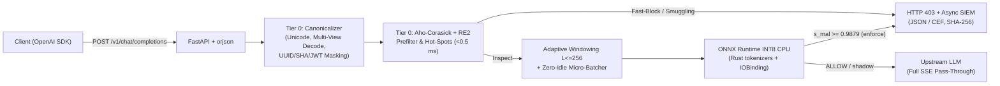
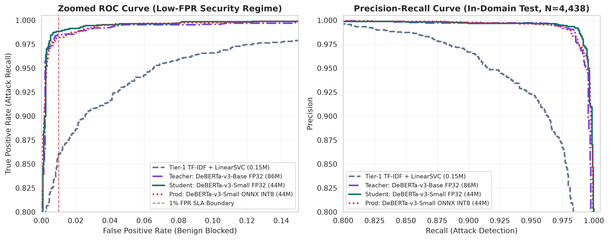
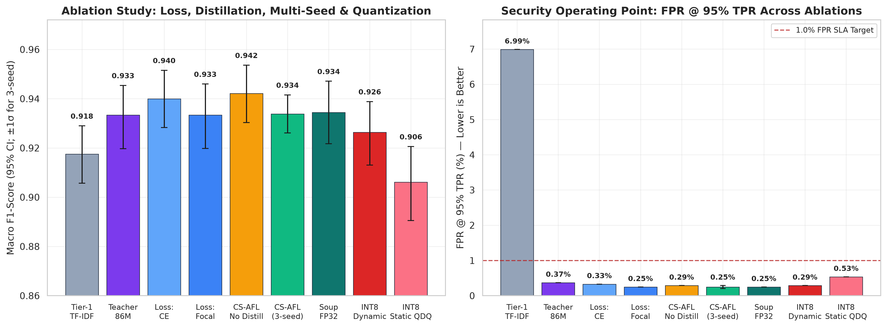

# AegisLLM

[](https://www.python.org/)
[](docs/architecture.md)
[-09090B)](reports/redteam_asr_report.json)
[](Dockerfile)
[](LICENSE)

**AegisLLM** is an inline, CPU-only AI Application Security Gateway deployed as a drop-in **OpenAI-compatible reverse proxy** (`POST /v1/chat/completions`, `/v1/completions`, `/v1/inspect`). It mitigates **OWASP LLM01 (Direct & Indirect Prompt Injection and Jailbreaks)** in real time with **zero GPU dependency** and **zero PyTorch/Transformers imports in production**.

---

## Key Capabilities

- **Hardened Deterministic Tier-0 (`< 0.5 ms`):** Single-source-of-truth canonicalizer defeating Plane-14 Unicode tag smuggling, Bidi Trojan Source (`CVE-2021-42574`), mixed-script UTR#39 homoglyphs, character spacing/interleaving, and recursive Base64/Hex/URL/ROT13 obfuscation — paired with a ReDoS-proof Aho-Corasick prefilter and structured UUID/SHA/JWT neural masking (`0.00%` identifier false positives while still inspecting decoded JWT claims).
- **Distilled DeBERTa-v3-Small ONNX INT8 Classifier (`44.1M` backbone):** Trained via 2-stage distillation from `deberta-v3-base` (`86M`), Cost-Sensitive Asymmetric Focal Loss (`CS-AFL`), FGM adversarial perturbations, and post-quantization temperature recalibration ($T_{\text{int8}} = 0.661$, $\tau_{95} = 0.9879$).
- **Sub-15 ms Interactive CPU Inference & Bounded Long-Context Windowing:** Rust `tokenizers` + ONNX Runtime `IOBinding` (`intra_op=8`) with zero-idle adaptive micro-batching, HTTP `429` backpressure, and `Head + Tail + Top-2 Hot-Spots` windowing catching buried attacks up to `4,096` tokens (`127.8 ms` P99).
- **Production Gateway Operations:** Full SSE streaming pass-through, `enforce` / `shadow` policy modes, Prometheus `/metrics`, privacy-preserving async SIEM audit logs (JSON / CEF with SHA-256 prompt hashing), and a **`326 MB`** non-root Docker image.

---

## Architecture



---

## Empirical Results (100% Measured)

Evaluated on a zero-leakage test corpus (**`N = 4,438`**, `602` MinHash LSH cross-contaminants purged), three isolated OOD suites (`XSTest`, `NotInject`, `JailbreakBench`, `N = 1,289`), a 270-vector OWASP red-team suite, and live FastAPI load tests on **AMD Ryzen 7 5800H (AVX2)**.

| Metric / Variant | Macro-F1 (95% CI) | ROC-AUC | FPR @ 95% TPR | DevOps FPR | XSTest Safe FPR | NotInject FPR | CPU P99 (ms) | McNemar vs Tier-1 |
| :--- | :---: | :---: | :---: | :---: | :---: | :---: | :---: | :---: |
| **Tier-1 Baseline (`TF-IDF + LinearSVC`)** | `0.918 ± 0.012` | `0.987` | `6.99%` | `8.33%` | `2.00%` | `23.60%` | `14.2 ms` | Ref ($H_0$) |
| **Teacher (`DeBERTa-v3-Base`, 86M FP32)** | `0.933 ± 0.013` | `0.998` | `0.37%` | `1.39%` | `0.00%` | `21.24%` | — | `p < 0.0001` |
| **Student FP32 (`CS-AFL + Distill`, 3-seed)** | **`0.934 ± 0.008`** | **`0.999`** | **`0.25% ± 0.04%`** | **`0.46%`** | **`0.00%`** | **`21.14% ± 7.86%`** | `21.5 ms` | `p < 0.0001` |
| **Prod: ONNX `INT8 Dynamic` (Recalibrated)** | **`0.926 ± 0.013`** | **`0.999`** | **`0.29%`** | **`1.39%`** | **`0.00%`** | `26.55%` | **`13.6 ms`** | **`p < 0.0001`** |
| **Challenger: ONNX `INT8 Static QDQ`** | `0.906 ± 0.015` | `0.998` | `0.53%` | `2.78%` | `0.00%` | `35.69%` | `16.5 ms` | `p < 0.0001` |

- **270-Vector OWASP Red-Team:** **`0.00%` ASR** (`210/210` attacks blocked across 10 evasion families), **`0.00%` identifier FPR** (`0/15` UUID/MD5/SHA/JWT), `3.33%` total hard-negative FPR.
- **Live Proxy Telemetry:** **`12.35 ms` P50 / `15.33 ms` Short-Benign P99** (`C=1`), **`176.4 req/s`** peak throughput (`C=16`), **`127.76 ms` P99** at `4,096` tokens (100% buried-attack blocking), **`326 MB`** non-root Docker image, **`693 MB`** live RSS (`393.5 MB` unpruned 128k SentencePiece FP32 vocab + `~41 MB` INT8 backbone + ORT arena).

| Low-FPR Security ROC / PR Regime | Loss, Distillation, Multi-Seed & Quantization Ablations |
| :---: | :---: |
|  |  |

Full 11-variant benchmark table, reliability diagram, confusion matrix, and length-curve plots are archived in [reports/benchmark_comparison_table.md](reports/benchmark_comparison_table.md) and [reports/figures/](reports/figures/).

---

## Quickstart

### 1. Run with Docker (326 MB Non-Root Runtime)

```bash
docker build -t aegis-llm:prod .
docker run -d --name aegis-gateway -p 8000:8000 \
  -v "$(pwd)/models/deberta_v3_small_aegis_v1:/app/models/deberta_v3_small_aegis_v1:ro" \
  -e AEGIS_UPSTREAM_URL="http://host.docker.internal:11434" \
  -e AEGIS_MODE="enforce" \
  aegis-llm:prod
```

Or launch the full proxy + mock upstream + Prometheus stack: `docker compose up --build`.

### 2. Point Any OpenAI SDK Client at AegisLLM

```python
from openai import OpenAI

client = OpenAI(base_url="http://localhost:8000/v1", api_key="sk-local")
resp = client.chat.completions.create(
    model="gpt-4o-mini",
    messages=[{"role": "user", "content": "Explain TLS 1.3 forward secrecy."}],
)
# Prompt injections / jailbreaks are rejected inline with HTTP 403 + SIEM audit event.
```

### 3. Local Development & Verification

```bash
python3 -m venv .venv && source .venv/bin/activate
pip install -e ".[runtime,dev,bench]"

PYTHONPATH=src pytest -v tests/
ruff check src/ tests/ scripts/ benchmarks/
mypy --strict src/aegis/
```

---

## Repository Structure

```text
AegisLLM/
├── src/
│   ├── aegis/                    # Zero-PyTorch production gateway
│   │   ├── proxy/                # FastAPI SSE reverse proxy, CLI, Prometheus & JSON/CEF audit
│   │   ├── runtime/              # ONNX Runtime IOBinding worker & zero-idle micro-batcher
│   │   └── security/             # Canonicalizer, Aho-Corasick prefilter & adaptive windowing
│   └── aegis_dl/                 # Training & evaluation library (CS-AFL, FGM, LLRD, soup, metrics)
├── benchmarks/                   # CPU ONNX quantization profiler, live proxy load & latency harnesses
├── configs/                      # Milestone 2 training & evaluation configuration
├── deploy/                       # Mock upstream LLM & Prometheus scrape configuration
├── docs/
│   ├── architecture.md           # Full system specification, AVX2 profiling & memory physics
│   ├── defense_brief_m2.md       # Experimental protocol, ablations, Threats to Validity & Q&A
│   ├── model_card.md             # Model Card (Mitchell et al., 2019)
│   └── data_card.md              # Data Card (Gebru et al., 2021)
├── reports/
│   ├── figures/                  # 5 publication-grade 300 DPI figures (PNG + PDF)
│   ├── predictions/              # Empirical .npz & metadata artifacts across 11 evaluated variants
│   ├── benchmark_comparison_table.{md,tex}
│   ├── error_analysis_m2.md      # Top-20 FP/FN taxonomy, OOD & red-team hardening deep dive
│   └── evaluation_summary.json   # Bootstrap CIs, McNemar tests & 3-seed mean ± std aggregates
├── scripts/                      # Zero-leakage dataset builder, GPU pipeline, OOD evaluator & figure gen
├── tests/                        # 38 unit, zero-leakage, ONNX parity, proxy & 270-vector red-team tests
├── Dockerfile                    # Multi-stage 326 MB non-root container
├── docker-compose.yml            # Proxy + mock upstream + Prometheus stack
└── pyproject.toml                # Split extras: [runtime] (zero PyTorch), [train], [dev], [bench]
```

---

## Authors & License

- **Evan Gendrot** — [@Evkune](https://github.com/Evkune) (INSA Rennes / ETSIINF — UPM)
- **Amaury Dubuc** — [@AmauryDubuc](https://github.com/AmauryDubuc) (INSA Rennes / ETSIINF — UPM)

Licensed under the [MIT License](LICENSE).
