# AegisLLM Architecture Specification & Empirical Engineering Trade-Offs

## 1. System Overview

**AegisLLM** is an inline, CPU-only AI Application Security Gateway deployed as an OpenAI-compatible reverse proxy (`POST /v1/chat/completions`, `POST /v1/completions`, `POST /v1/inspect`). It mitigates **OWASP Top 10 for LLM Applications — LLM01 (Prompt Injection & Jailbreak)** across direct user prompts and indirect RAG/tool outputs with **zero GPU runtime dependency** and **zero PyTorch/Transformers imports in production**.

## 2. Production In-Line Architecture

```mermaid
flowchart LR
    Client["Client (OpenAI SDK)"] -->|"POST /v1/chat/completions"| Ingress["FastAPI + orjson<br/>(~0.2 ms)"]
    Ingress --> Roles["Role Extractor<br/>(tool/function + last k=3 user)"]
    Roles --> Canon["Tier 0: Canonicalizer<br/>(Plane-14, Bidi, UTR#39, Multi-View Decode)"]
    Canon --> Prefilter["Tier 0: Aho-Corasick + RE2-Safe<br/>Prefilter & Hot-Spot Scorer (< 0.5 ms)"]
    Prefilter -->|"Fast-Block / Smuggling"| Block403["HTTP 403 + Async SIEM Log<br/>(JSON / CEF, SHA-256 prompt hash)"]
    Prefilter -->|"Inspect"| Window["Adaptive Windowing L <= 256<br/>(Dynamic Short / Head+Tail+Top-2 Hot-Spots)"]
    Window --> Batcher["Zero-Idle Adaptive Micro-Batcher<br/>(Length Bucketing + HTTP 429 Backpressure)"]
    Batcher --> ORT["ONNX Runtime CPU Worker<br/>(Rust tokenizers + IOBinding, intra_op=8)"]
    ORT --> Policy["Calibrated Temp Scaling T_int8 +<br/>Window Max-Pooling"]
    Policy -->|"s_mal >= tau (enforce)"| Block403
    Policy -->|"ALLOW / shadow"| Upstream["Persistent httpx Pool<br/>(Full SSE Streaming Pass-Through)"]
```

## 3. Defense-in-Depth Pipeline Stages

### Stage 1 — Role-Aware Surface Extraction (`src/aegis/security/windowing.py`)
- Inspects untrusted surfaces only: all `tool` and `function` messages (primary indirect prompt injection surface in RAG/agentic systems) plus the last `k = 3` `user` turns (mitigating multi-turn crescendo splits while bounding compute).
- Handles both plain string `content` and OpenAI multimodal list-of-parts content blocks. Trusted `system`/`developer` prompts are skipped by default.

### Stage 2 — Single-Source-of-Truth Canonicalizer (`src/aegis/security/canonicalizer.py`)
Shared directly with `src/aegis_dl/normalization.py` to prevent train/serving skew:
- **Unicode Tag Smuggling (`U+E0000–U+E007F`):** Decodes hidden ASCII tag payloads into secondary inspection views and flags `anomaly:unicode_tag_smuggling` (hard-block) while tolerating valid emoji subdivision flag sequences (`U+1F3F4 + [a-z0-9]{2,6} + U+E007F`).
- **Bidi Trojan Source (CVE-2021-42574):** Detects and strips explicit bidirectional override/isolate controls (`U+202A–U+202E`, `U+2066–U+2069`).
- **Targeted UTR#39 Confusables:** Folds Cyrillic/Greek lookalikes strictly on mixed-script words or security-keyword skeletons inside Latin contexts — preserving legitimate Russian/Greek/French/Spanish prompts with 0% false positives.
- **Anti-Spacing & Anti-Interleaving:** Collapses Cisco-style spaced characters (`I g n o r e  a l l`) and delimiter interleaving (`I.g.n.o.r.e`, `p-r-e-v-i-o-u-s`) while ignoring short acronyms (`U.S.A.`, `e.g.`).
- **Bounded Multi-View De-Obfuscation (Depth <= 2, Views <= 4):** Unwraps Base64, Base64URL, nested Base64, raw/escaped Hex, URL percent-encoding, and hinted ROT13 with strict false-positive shields for **UUIDv4, SHA-256, MD5, Git SHAs, and valid 3-part JWT Bearer tokens**.

### Stage 3 — Deterministic Tier-0 Prefilter & O(n) Hot-Spot Scorer (`src/aegis/security/prefilter.py`)
- Pure-Python **Aho-Corasick automaton** (`O(n + z)` linear time, zero backtracking / ReDoS-proof) combined with strictly bounded linear-time regex signatures.
- Fast-blocks unambiguous delimiter spoofing (`<|im_start|>system`, `[INST] <<SYS>>`), explicit instruction overrides, system prompt extraction, and Markdown image exfiltration in `< 0.5 ms`.
- Deferral guardrails prevent fast-blocking defensive security education queries (e.g., *"Explain what prompt injection is..."*), routing them to semantic neural evaluation.
- Emits disjoint **Top-2 Hot-Spot spans** via two-pointer sweep + NMS so long RAG contexts (`> 256` tokens) pinpoint buried injections without running ONNX across the full document.

### Stage 4 — Adaptive Dynamic Windowing & Zero-Idle Micro-Batcher (`windowing.py`, `batcher.py`)
- **Short Prompts (`L <= 64` / `L <= 256`):** Never padded to 256! Dynamic per-batch padding rounded to multiple of 8 preserves the measured **`13.59 ms` P99 latency at `L = 64`** on AMD Ryzen 7 5800H.
- **Long Prompts / RAG (`L > 256`):** Emits `Head (256) + Tail (256) + Top-2 Hot-Spots (256)` aggregated via **Max-Pooling** over calibrated $s_{\text{mal}} = P(\text{INJECTION}) + P(\text{JAILBREAK})$.
- **Zero-Idle Micro-Batcher:** Dispatches immediately (`0 ms` idle wait) when worker is free (`C = 1`), coalesces up to `max_batch_size` (`<= 1.0 ms` window) under load, groups by length bucket (`64 / 128 / 256`), and enforces **HTTP 429 backpressure** when the queue reaches `max_queue_size`.

### Stage 5 — Zero-PyTorch ONNX Runtime Engine (`src/aegis/runtime/onnx_engine.py`)
- Uses pure Rust `tokenizers.Tokenizer` + `onnxruntime.InferenceSession` (`CPUExecutionProvider`) with **`IOBinding`** and tuned threading (`intra_op_num_threads = 8`, `inter_op_num_threads = 1`, `ORT_SEQUENTIAL`).
- Applies post-quantization recalibrated temperature scaling $T_{\text{int8}}$ and validation-tuned operating thresholds $(\tau_{95}, \tau_{1\%})$ loaded from `model_metadata.json`.

## 4. Empirical CPU Profiling on Target Hardware (AMD Ryzen 7 5800H, 8C/16T Zen 3 AVX2)

Measured via `benchmarks/profile_onnx_cpu.py` (`onnxruntime 1.32.0`, `reports/cpu_onnx_profile.md`):

| Quantization Variant | Size (MB) | Top-1 Parity vs FP32 | `L=64, B=1` E2E P99 | `L=128, B=1` E2E P99 | `L=256, B=1` E2E P99 | `L=512, B=1` E2E P99 |
| :--- | :---: | :---: | :---: | :---: | :---: | :---: |
| `fp32_opt` (`intra_op=8`) | `558.0` | `100.0%` | `21.46 ms` | `37.29 ms` | `88.17 ms` | `274.32 ms` |
| **`int8_dynamic` (`intra_op=8`)** | **`434.9`** | **`100.0%`** | **`13.59 ms` (PASS)** | **`27.72 ms`** | **`59.66 ms`** | **`257.33 ms`** |
| `int8_static_qdq` (`intra_op=8`) | `436.7` | `91.7%` | `16.54 ms` | `27.78 ms` | `76.88 ms` | `251.30 ms` |

**Key Architectural Takeaways:**
1. On Zen 3 AVX2 (no AVX-512 VNNI), **`int8_dynamic`** dominates `int8_static_qdq` on both latency (`13.59 ms` vs `16.54 ms` at `L=64`) and numerical parity (`100.0%` vs `91.7%` Top-1 agreement).
2. Exclusions (`embeddings`, `rel_embeddings`, `classifier`, `pooler`, `layernorm`, `_proj_1`) plus `ORT_ENABLE_BASIC` pre-optimization prevent numerical collapse in DeBERTa-v3 disentangled relative attention.
3. Dynamic sequence padding (never padding short prompts to 256) keeps interactive short queries (`> 55%` of traffic, `L <= 64`) strictly under the **`15.0 ms` P99 SLA**, while two `L = 256` windows (`160.13 ms` batched) remain `1.6x` faster than a single `L = 512` pass (`257.33 ms`).

## 5. Observability, Security Operations & Packaging
- **Modes:** `enforce` (HTTP 403 OpenAI-compatible policy error) and `shadow` (forwards upstream with `X-Aegis-Decision: shadow-block` header).
- **Observability:** Prometheus `/metrics` exposing request counters, fast-block counters, HTTP 429 backpressure counters, per-stage latency histograms (`canonicalize`, `prefilter`, `windowing`, `queue_wait`, `onnx`, `e2e`), queue depth, and process RSS bytes.
- **Privacy-Preserving SIEM Audit:** Asynchronous JSON-lines or CEF (`CEF:0|AegisLLM|SecurityGateway|1.0|...`) logger storing SHA-256 hashes of prompts by default (`AEGIS_LOG_RAW_PROMPT=false`).
- **Container Footprint:** Multi-stage `python:3.11-slim` Docker image built strictly with `.[runtime]` (zero PyTorch/Transformers), verified at **`310.6 MB`** (`< 350 MB` excluding mounted weights) running as non-root UID `10001`.
