# AegisLLM Architecture Specification & Empirical Engineering Trade-Offs

## 1. System Overview

**AegisLLM** is an inline, CPU-only AI Application Security Gateway deployed as an OpenAI-compatible reverse proxy (`POST /v1/chat/completions`, `POST /v1/completions`, `POST /v1/inspect`). It mitigates **OWASP Top 10 for LLM Applications — LLM01 (Prompt Injection & Jailbreak)** across direct user prompts and indirect RAG/tool outputs with **zero GPU runtime dependency** and **zero PyTorch/Transformers imports in production**.

## 2. Production In-Line Architecture

```mermaid
flowchart LR
    Client["Client (OpenAI SDK)"] -->|"POST /v1/chat/completions"| Ingress["FastAPI + orjson<br/>(~0.2 ms)"]
    Ingress --> Roles["Role Extractor<br/>(tool/function + last k=3 user)"]
    Roles --> Canon["Tier 0: Canonicalizer<br/>(Plane-14, Bidi, UTR#39, Multi-View Decode +<br/>Structured ID Neural Masking)"]
    Canon --> Prefilter["Tier 0: Aho-Corasick + RE2-Safe<br/>Prefilter & Hot-Spot Scorer (< 0.5 ms)"]
    Prefilter -->|"Fast-Block / Smuggling"| Block403["HTTP 403 + Async SIEM Log<br/>(JSON / CEF, SHA-256 prompt hash)"]
    Prefilter -->|"Inspect"| Window["Adaptive Windowing L <= 256<br/>(Dynamic Short / Head+Tail+Top-2 Hot-Spots)"]
    Window --> Batcher["Zero-Idle Adaptive Micro-Batcher<br/>(Length Bucketing + HTTP 429 Backpressure)"]
    Batcher --> ORT["ONNX Runtime CPU Worker<br/>(Rust tokenizers + IOBinding, intra_op=8)"]
    ORT --> Policy["Calibrated Temp Scaling T_int8 = 0.661 +<br/>Window Max-Pooling (tau_95 = 0.9879)"]
    Policy -->|"s_mal >= tau (enforce)"| Block403
    Policy -->|"ALLOW / shadow"| Upstream["Persistent httpx Pool<br/>(Full SSE Streaming Pass-Through)"]
```

## 3. Defense-in-Depth Pipeline Stages

### Stage 1 — Role-Aware Surface Extraction (`src/aegis/security/windowing.py`)
- Inspects untrusted surfaces only: all `tool` and `function` messages (primary indirect prompt injection surface in RAG/agentic systems) plus the last `k = 3` `user` turns (mitigating multi-turn crescendo splits while bounding compute).
- Handles both plain string `content` and OpenAI multimodal list-of-parts content blocks. Trusted `system`/`developer` prompts are skipped by default.

### Stage 2 — Single-Source-of-Truth Canonicalizer (`src/aegis/security/canonicalizer.py`)
Shared directly with `src/aegis_dl/normalization.py` to prevent train/serving skew:
- **Unicode Tag Smuggling (`U+E0000–U+E007F`):** Decodes hidden ASCII tag payloads into secondary inspection views and flags `anomaly:unicode_tag_smuggling` (hard-block) while tolerating valid emoji subdivision flag sequences (`U+1F3F4 + [a-z0-9]{2,6} + U+E007F`).
- **Bidi Trojan Source (CVE-2021-42574):** Detects and strips explicit bidirectional override/isolate controls (`U+202A–U+202E`, `U+2066–U+2069`).
- **Targeted UTR#39 Confusables:** Folds Cyrillic/Greek lookalikes strictly on mixed-script words or security-keyword skeletons inside Latin contexts — preserving legitimate Russian/Greek/French/Spanish prompts with `0.0 %` false positives.
- **Anti-Spacing & Anti-Interleaving:** Collapses Cisco-style spaced characters (`I g n o r e  a l l`) and delimiter interleaving (`I.g.n.o.r.e`, `p-r-e-v-i-o-u-s`) while ignoring short acronyms (`U.S.A.`, `e.g.`).
- **Bounded Multi-View De-Obfuscation (Depth $\le 2$, Views $\le 4$):** Unwraps Base64, Base64URL, nested Base64, raw/escaped Hex, URL percent-encoding, and hinted ROT13.
- **Structured Cryptographic Identifier Neural Masking (`neural_views`):** Live red-teaming on the trained ONNX INT8 model revealed that raw UUIDv4, MD5/SHA-1/SHA-256 digests, and valid 3-part JWT tokens fragment into ~45 rare SentencePiece subwords that mimic adversarial GCG/encoded payloads (`66.7 %` FPR on raw identifiers). Replacing verified non-ASCII hex digests (`hex checksum`), UUIDs (`uuid value`), valid JWTs (`jwt token`), and single inline backticks (preserving triple-backtick fences) inside `neural_views` — while still decoding natural-language JWT payload claims into secondary views to catch claim smuggling — eliminates identifier false positives completely (**`0/15` = `0.0 %` FPR**) with **`0.0 %` ASR (`210/210` attacks blocked)**.

### Stage 3 — Deterministic Tier-0 Prefilter & $O(n)$ Hot-Spot Scorer (`src/aegis/security/prefilter.py`)
- Pure-Python **Aho-Corasick automaton** ($O(n + z)$ linear time, zero backtracking / ReDoS-proof) combined with strictly bounded linear-time regex signatures.
- Fast-blocks unambiguous delimiter spoofing (`<|im_start|>system`, `[INST] <<SYS>>`), explicit instruction overrides, system prompt extraction, and Markdown image exfiltration in **`0.14 ms` median (`0.46 ms` mean)**.
- Deferral guardrails prevent fast-blocking defensive security education queries (e.g., *"Explain what prompt injection is..."*), routing them to semantic neural evaluation (`0.0 %` FPR on `hard_negative_security_edu`).
- Emits disjoint **Top-2 Hot-Spot spans** via two-pointer sweep + NMS so long RAG contexts (`> 256` tokens) pinpoint buried injections without running ONNX across the full document.

### Stage 4 — Adaptive Dynamic Windowing & Zero-Idle Micro-Batcher (`windowing.py`, `batcher.py`)
- **Short Prompts (`L <= 64` / `L <= 256`):** Never padded to `256`. Dynamic per-batch padding rounded to a multiple of `8` preserves the measured **`13.59 ms` P99 isolated ORT latency at `L = 64`** on AMD Ryzen 7 5800H (covering `> 55 %` of interactive traffic).
- **Long Prompts / RAG (`L > 256`):** Emits `Head (256) + Tail (256) + Top-2 Hot-Spots (256)` aggregated via **Max-Pooling** over calibrated $s_{\text{mal}} = P(\text{INJECTION}) + P(\text{JAILBREAK})$. Live proxy verification up to **`4,096` tokens** bounds P99 latency at **`127.76 ms`** (sub-linear vs quadratic $O(L^2)$ attention) while detecting buried mid-document injections (`buried_blocked = True` at `512`, `1,024`, and `4,096` tokens).
- **Zero-Idle Micro-Batcher:** Dispatches immediately (`0 ms` idle wait) when the worker is free (`C = 1`), coalesces up to `max_batch_size` ($\le 1.0\text{ ms}$ window) under concurrency, groups by length bucket (`64 / 128 / 256`), and enforces **HTTP 429 backpressure** when the queue reaches `max_queue_size`.

### Stage 5 — Zero-PyTorch ONNX Runtime Engine (`src/aegis/runtime/onnx_engine.py`)
- Uses pure Rust `tokenizers.Tokenizer` + `onnxruntime.InferenceSession` (`CPUExecutionProvider`) with **`IOBinding`** and tuned threading (`intra_op_num_threads = 8`, `inter_op_num_threads = 1`, `ORT_SEQUENTIAL`).
- Applies post-quantization recalibrated temperature scaling ($T_{\text{int8}} = 0.6609$) and validation-tuned operating thresholds ($\tau_{95} = 0.9879$, $\tau_{1\%} = 0.4449$) loaded from `models/deberta_v3_small_aegis_v1/model_metadata.json`.

---

## 4. Empirical CPU Profiling & Live Proxy Load Telemetry

All measurements collected on **AMD Ryzen 7 5800H** (8C/16T Zen 3 AVX2, no AVX-512 VNNI), `onnxruntime 1.32.0`, running the trained production artifact `model_int8_dynamic.onnx` (`434.94 MB`).

### 4.1 Isolated Quantization & Threading Matrix (`reports/cpu_onnx_profile.md`)

| Quantization Variant | File Size | Top-1 Parity vs FP32 (Test `N=4,438`) | `L=64, B=1` E2E P99 | `L=128, B=1` E2E P99 | `L=256, B=1` E2E P99 | `L=512, B=1` E2E P99 |
| :--- | :---: | :---: | :---: | :---: | :---: | :---: |
| `fp32_opt` (`intra_op=8`) | `558.0 MB` | `100.00 %` | `21.46 ms` | `37.29 ms` | `88.17 ms` | `274.32 ms` |
| **`int8_dynamic` (`intra_op=8`)** | **`434.9 MB`** | **`98.76 %` (`KL=0.0064`)** | **`13.59 ms` (PASS)** | **`27.72 ms`** | **`59.66 ms`** | **`257.33 ms`** |
| `int8_static_qdq` (`intra_op=8`) | `436.7 MB` | `95.92 %` (`KL=0.0573`) | `16.54 ms` | `27.78 ms` | `76.88 ms` | `251.30 ms` |

**Key AVX2 Physics Takeaways:**
1. On Zen 3 AVX2, **`int8_dynamic`** dominates `int8_static_qdq` on both latency (`13.59 ms` vs `16.54 ms` at `L=64`) and fidelity (`98.76 %` vs `95.92 %` agreement; `0.9263` vs `0.9061` Macro-F1; $\Delta\text{FPR} = +0.04\%$ vs $+0.08\%$).
2. Excluding sensitive layers (`embeddings`, `rel_embeddings`, `classifier`, `pooler`, `layernorm`, `_proj_1`) + `ORT_ENABLE_BASIC` pre-optimization prevents numerical collapse in DeBERTa-v3's disentangled relative attention.
3. **Honest Memory Physics (RSS Breakdown):** `model_int8_dynamic.onnx` is `434.94 MB` because DeBERTa-v3's 128,100-token SentencePiece FP32 embedding table accounts for **`393.5 MB`** (`98.4 M` params $\times$ 4 bytes), while the 6-layer INT8 Transformer backbone occupies only **`~41 MB`**. Consequently, live proxy RSS stabilizes at **`693–698 MB`** under concurrency (`435 MB` model weights + ORT memory arena + FastAPI/Rust tokenizers), exceeding the initial Milestone 1 target of `500 MB` without vocabulary pruning — a transparent architectural trade-off documented for Milestone 3 (vocab pruning to 32k tokens drops embedding size to `98 MB` and total RSS to `< 350 MB`).

### 4.2 Live End-to-End FastAPI Proxy Concurrency Benchmark (`reports/load_test_results.json`)
Measured against the real FastAPI proxy (`enforce` mode, `model_int8_dynamic.onnx`) + mock upstream LLM over loopback HTTP:

| Concurrency (`C`) | Requests | Throughput (req/s) | E2E P50 (ms) | E2E P95 (ms) | E2E P99 (ms) | Short Benign P99 (ms) | Peak RSS (MB) | HTTP Statuses |
| :---: | :---: | :---: | :---: | :---: | :---: | :---: | :---: | :--- |
| `1` | `64` | `90.9` | `12.35` | `15.71` | `16.77` | `15.33` | `693.2` | `52 × 200`, `12 × 403` |
| `4` | `64` | `168.2` | `26.97` | `33.13` | `33.70` | `33.08` | `693.3` | `52 × 200`, `12 × 403` |
| `16` | `64` | **`176.4`** | `91.17` | `121.88` | `143.78` | `144.13` | `697.1` | `52 × 200`, `12 × 403` |
| `32` | `128` | `171.6` | `164.78` | `297.64` | `373.91` | `379.04` | `697.5` | `104 × 200`, `24 × 403` |

### 4.3 Live Proxy Latency vs. Prompt Length (`reports/latency_length_curve.json`)

| Prompt Length (`L` tokens) | Windows Inspected | E2E P50 (ms) | E2E P95 (ms) | E2E P99 (ms) | Buried Mid-Doc Attack Blocked? |
| :---: | :---: | :---: | :---: | :---: | :---: |
| `32` | `1` | `13.79` | `15.86` | `15.89` | — |
| `64` | `1` | `22.93` | `29.89` | `30.43` | — |
| `128` | `1` | `43.03` | `51.31` | `51.34` | — |
| `256` | `2` | `78.76` | `99.74` | `99.90` | — |
| `512` | `2` | `68.48` | `75.97` | `78.62` | **Yes (`block`)** |
| `1,024` | `2` | `82.15` | `100.34` | `112.56` | **Yes (`block`)** |
| `4,096` | `2` | `118.24` | `125.87` | `127.76` | **Yes (`block`)** |

---

## 5. Observability, Security Operations & Packaging
- **Modes:** `enforce` (HTTP 403 OpenAI-compatible policy error) and `shadow` (forwards upstream with `X-Aegis-Decision: shadow-block` header). Full SSE pass-through (`stream: true`) verified end-to-end.
- **Observability:** Prometheus `/metrics` exposing request counters (`aegis_requests_total`), fast-block counters, HTTP 429 backpressure counters, per-stage latency histograms (`aegis_stage_latency_ms` across `canonicalize`, `prefilter`, `windowing`, `queue_wait`, `onnx`, `e2e`), queue depth, and process RSS bytes.
- **Privacy-Preserving SIEM Audit:** Asynchronous JSON-lines or CEF (`CEF:0|AegisLLM|SecurityGateway|1.0|...`) logger storing SHA-256 hashes of prompts by default (`AEGIS_LOG_RAW_PROMPT=false`).
- **Container Footprint:** Multi-stage `python:3.11-slim` Docker image built strictly with `.[runtime]` (zero PyTorch/Transformers), verified at **`326 MB`** (`< 350 MB` excluding mounted weights) running as non-root UID `10001`. Live Docker smoke test verified `/healthz`, `/readyz` (`onnx_loaded: true`), `/v1/inspect`, `/v1/chat/completions` (`200`/`403` in `enforce`, `200` in `shadow`), and `/metrics`.
