# AegisLLM — Milestone 2: Design of Experiments (DOE) Report

**Course:** Software Engineering for Deep Learning (103001022) — ETSIINF, Universidad Politécnica de Madrid  
**Authors:** Evan Gendrot & Amaury Dubuc  
**System Under Test:** AegisLLM (`microsoft/deberta-v3-small`, 44.1M backbone — OWASP LLM01 Prompt Injection & Jailbreak Firewall)  
**Statistical Dataset:** `reports/doe/doe_raw_data.csv` | **Analysis Script:** `scripts/analyze_doe_anova.py`

---

## 1.- Experiment Planning and Definition

### 1.1 Experimental Goal (GQM Framing)
**Analyze** the training loss formulation and teacher-to-student knowledge distillation **for the purpose of** evaluating their main and interaction effects **with respect to** low-FPR in-domain security detection, out-of-distribution (OOD) benign trigger-word false positives, and 3-class classification balance **from the point of view of** an AI security engineer **in the context of** an inline CPU-only `DeBERTa-v3-Small` prompt-injection gateway (`L <= 256`).

### 1.2 Response Variables (Dependent Variables)
Three continuous response variables in $[0, 1]$ are evaluated for every experimental run after locking temperature calibration ($T$) and operating threshold ($\tau_{95}$) strictly on the isolated Validation split ($N = 4{,}439$):

| Role | Variable Name (`CSV` column) | Operational Definition | Dataset Evaluated | Optimization Direction |
| :--- | :--- | :--- | :--- | :---: |
| **Primary Security** | `fpr_at_95_tpr` | False Positive Rate on benign prompts when evaluated at the Validation-locked 95% attack recall operating point $\tau_{95}$ (`s_mal = 1 - P(BENIGN) >= tau_95`). | Held-out Test ($N = 4{,}438$; $2{,}433$ benign) | **Minimize** |
| **Co-Primary OOD** | `notinject_fpr` | False Positive Rate on benign prompts intentionally enriched with 1–3 injection trigger keywords (e.g., `ignore`, `system`, `policy`) at the same locked $\tau_{95}$. | Isolated OOD `NotInject` ($N = 339$; 100% benign) | **Minimize** |
| **Utility / Balance** | `macro_f1` | Unweighted 3-class Macro-F1 across `BENIGN` (0), `PROMPT_INJECTION` (1), and `JAILBREAK` (2) under `argmax` over calibrated probabilities. | Held-out Test ($N = 4{,}438$) | **Maximize** |
| *Diagnostic (raw CSV)* | `roc_auc`, `ece` | Binary malicious discrimination (`ROC-AUC`) and 15-bin Expected Calibration Error (`ECE`) after post-hoc Temperature Scaling. | Held-out Test ($N = 4{,}438$) | Max / Min |

### 1.3 Factors and Levels (Treatments)
Two controlled categorical factors are varied ($\le 3$ factors as required), yielding $2 \times 2 = 4$ treatment combinations:

| Factor | Symbol | Levels (Treatments) | Technical Specification |
| :--- | :---: | :--- | :--- |
| **Factor A — Loss Function** | `loss` | `ce` (baseline) `cs_afl` (proposed) | **`ce`:** Standard unweighted multi-class Cross-Entropy. **`cs_afl`:** Cost-Sensitive Asymmetric Focal Loss with class weights $[1.0, 1.35, 3.01]$, focusing exponents $\gamma = [2.5, 1.5, 2.0]$, asymmetric FP penalty $\beta_{\text{fp}} = 2.25$, and label smoothing $\epsilon = 0.03$. |
| **Factor B — Knowledge Distillation** | `distillation` | `off` (baseline) `on` (proposed) | **`off`:** Supervised training from hard ground-truth labels only ($\alpha_{\text{distill}} = 0.0$). **`on`:** Hybrid KL-divergence soft-target distillation ($\alpha_{\text{distill}} = 0.40, T_{\text{kd}} = 2.0$) from the frozen fine-tuned `microsoft/deberta-v3-base` teacher (`models/teacher_train_logits.pt`). |

### 1.4 Blocking Variables
**No blocking variable is introduced** in the primary design (Completely Randomized Factorial Design — CRFD):
- All 20 experimental runs execute on identical hardware and numerical precision (single Google Colab GPU SKU, deterministic **FP32**) over the exact same frozen zero-leakage train/val/test/OOD partitions and the exact same cached Teacher logits file.
- The 5 random seeds `{42, 1337, 2026, 777, 999}` act as **independent stochastic replications** per treatment cell (governing classifier head initialization, dropout masks, and mini-batch length-bucket shuffling) rather than heterogeneous subjects with shared intrinsic characteristics across distinct optimization landscapes.
- *Design Safeguard:* Hardware GPU SKU would act as a nuisance blocking factor if mixed (e.g., T4 vs. L4); this nuisance is eliminated by holding GPU SKU and FP32 precision strictly constant across all 20 runs.

### 1.5 Contextual Variables Held Constant
Every factor outside `loss` and `distillation` is held strictly constant across all 20 DOE runs (`reports/predictions_doe_fast/`). Once the factorial DOE identifies the statistically optimal `(loss, distillation)` combination, that winning configuration feeds into the full Milestone 2 production hardening recipe (3 epochs + FGM adversarial training + Greedy Model Soup + ONNX INT8 Dynamic export).

| Contextual Variable | Fixed Value / Specification (DOE Protocol) |
| :--- | :--- |
| Student Backbone | `microsoft/deberta-v3-small` (`44.1M` params, 6 Transformer layers, 128k SentencePiece vocab) |
| Sequence Windowing | `max_sequence_length = 256`, `pad_to_multiple_of = 8`, `truncation = True` |
| Dataset & Zero-Leakage Split | `data/processed/{train,val,test}.parquet` (`20,878` / `4,439` / `4,438`); `602` MinHash LSH OOD duplicates purged (`Jaccard >= 0.75`); `StratifiedGroupKFold(n_splits=20)` over `23,712` clusters |
| OOD Stress Suites | `data/ood/notinject.parquet` ($N=339$), `xstest.parquet` ($N=450$), `jbb.parquet` ($N=500$) |
| Training Schedule | `2` epochs (`1,304` optimizer steps), cosine decay with `10%` linear warmup, uniform end-of-epoch validation checkpoint selection (`keep_ckpts = False`) |
| Batching & Effective Batch | `LengthBucketedBatchSampler(batch_size=16, mega_mult=40)` + `grad_accum = 2` (effective batch = `32`) |
| Optimizer & LLRD | `AdamW` (`backbone_lr = 2.5e-5`, `head_lr = 8.0e-5`, `llrd_decay = 0.90`, `betas = (0.9, 0.98)`, `eps = 1e-6`, `weight_decay = 0.01`, `max_grad_norm = 1.0`) |
| Adversarial Training (FGM) | Held constant at `OFF` (`--disable-fgm`) during the factorial DOE to isolate `Loss × Distillation` without second-order adversarial perturbation confounding; enabled in final production hardening |
| Teacher Model (for `distillation=on`) | Frozen `microsoft/deberta-v3-base` (86.0M) soft logits cached in `models/teacher_train_logits.pt` (`float16`, shape `[20878, 3]`) |
| Calibration & Operating Point | Post-hoc `TemperatureScaler` fitted strictly on Validation (`val.parquet`); $\tau_{95}$ and $\tau_{1\%}$ locked on Validation ROC before blind Test/OOD inference |
| Hardware & Numerical Precision | Single uniform Google Colab GPU SKU across all 20 runs, explicit **FP32** (`model.float()`) |

### 1.6 Hypotheses Formulation ($\alpha = 0.05$)
For each response variable $Y \in \{\text{fpr\_at\_95\_tpr},\ \text{notinject\_fpr},\ \text{macro\_f1}\}$:
- **Main Effect of Factor A (Loss):**
  - $H_{0,A}: \mu_{\text{ce}} = \mu_{\text{cs\_afl}}$ (loss function has no effect on mean $Y$)
  - $H_{1,A}: \mu_{\text{ce}} \neq \mu_{\text{cs\_afl}}$
- **Main Effect of Factor B (Distillation):**
  - $H_{0,B}: \mu_{\text{off}} = \mu_{\text{on}}$ (knowledge distillation has no effect on mean $Y$)
  - $H_{1,B}: \mu_{\text{off}} \neq \mu_{\text{on}}$
- **Interaction Effect (Loss $\times$ Distillation):**
  - $H_{0,AB}: (\alpha\beta)_{ij} = 0\ \forall i, j$ (the effect of Loss does not depend on whether Distillation is enabled)
  - $H_{1,AB}: \exists\, i, j\text{ such that }(\alpha\beta)_{ij} \neq 0$

---

## 2.- Experimental Design

### 2.1 Design Type and Sample Size
- **Design Structure:** Balanced **$2 \times 2$ Full Factorial Design** without blocks (Completely Randomized Factorial Design).
- **Replications per Treatment Cell:** $r = 5$ independent stochastic replications (`seed ∈ {42, 1337, 2026, 777, 999}`), satisfying the minimum requirement of $\ge 5$ replications per factor-level combination.
- **Total Experimental Runs:** $N = a \times b \times r = 2 \times 2 \times 5 = \mathbf{20}$ runs.
- **Degrees of Freedom Allocation:** $df_{\text{Loss}} = 1$, $df_{\text{Distill}} = 1$, $df_{\text{Loss} \times \text{Distill}} = 1$, $df_{\text{Residual}} = N - ab = 16$, $df_{\text{Total}} = 19$.

| Treatment Cell | Factor A (`loss`) | Factor B (`distillation`) | Replications ($r = 5$ seeds) | Run ID Pattern |
| :---: | :---: | :---: | :--- | :--- |
| $T_{11}$ | `ce` | `off` | `42, 1337, 2026, 777, 999` | `deberta_v3_small_ce_no_distill_seed{s}` |
| $T_{12}$ | `ce` | `on` | `42, 1337, 2026, 777, 999` | `deberta_v3_small_ce_seed{s}` |
| $T_{21}$ | `cs_afl` | `off` | `42, 1337, 2026, 777, 999` | `deberta_v3_small_cs_afl_no_distill_seed{s}` |
| $T_{22}$ | `cs_afl` | `on` | `42, 1337, 2026, 777, 999` | `deberta_v3_small_cs_afl_seed{s}` |

### 2.2 Experimental Operation
1. **Pre-Experiment Data Hygiene Gate:** Freeze `data/processed/{train,val,test}.parquet` and `data/ood/*.parquet` and verify zero cluster/OOD leakage via `pytest tests/test_zero_leakage.py`.
2. **Teacher Logit Caching (Executed Once):** Load the verified `models/teacher_train_logits.pt` (`20,878 × 3`, `float16`) produced by Stage 1 fine-tuning of `microsoft/deberta-v3-base`, guaranteeing identical soft supervision for all 10 `distillation=on` runs.
3. **Randomized Resilient Batch Execution (`scripts/run_doe_batch.py`):**
   - Permute the 20-run matrix using a recorded PRNG seed (`--order-seed 2026`, persisted in `reports/doe/run_order.json`) to neutralize chronological hardware drift across Colab sessions.
   - For each run: call `seed_everything(seed)`, instantiate a fresh pretrained `microsoft/deberta-v3-small` model in FP32, train with the assigned `(loss, distillation)` treatment, select the best checkpoint strictly by Validation loss, fit `TemperatureScaler` on Validation logits, lock $\tau_{95}$ and $\tau_{1\%}$ on Validation calibrated probabilities, perform a single blind inference pass on Test and OOD suites, persist immutable `<run_key>_test.npz` and `<run_key>_meta.json` artifacts immediately (with Drive backup / Colab auto-download and a 4-minute kernel keep-alive heartbeat), and explicitly free GPU memory (`gc.collect()` + `torch.cuda.empty_cache()`).
4. **Automated Statistical Pipeline (`scripts/analyze_doe_anova.py`):** Load all 20 `.npz` / `_meta.json` artifacts, export the tidy raw dataset `reports/doe/doe_raw_data.csv`, compute descriptive statistics, render 300 DPI single-factor boxplots, Q-Q residual plots, and interaction plots, validate ANOVA assumptions (Shapiro-Wilk + Levene), compute Type II/III ANOVA tables and Tukey HSD post-hoc comparisons, and populate Section 3.

### 2.3 Control of Threats to Internal Validity

| Internal Validity Threat | Concrete Risk in Deep Learning DOE | Control Mechanism Applied |
| :--- | :--- | :--- |
| **History / Hardware Drift** | Thermal throttling or differing Colab container allocations over multi-hour GPU sessions could bias earlier vs. later treatments. | Execution order of all 20 runs is fully randomized (`--order-seed 2026`, logged in `reports/doe/run_order.json`), and GPU SKU + FP32 precision are held strictly uniform. |
| **Maturation / Carry-Over** | Weights, optimizer momentum states, or CUDA caches leaking between consecutive training runs inside one session. | Fresh `AutoModelForSequenceClassification.from_pretrained`, fresh `AdamW`/scheduler, fresh RNG seeding (`seed_everything`), and explicit `gc.collect()` + `torch.cuda.empty_cache()` after every run. |
| **Instrumentation** | Discrepancies in metric definitions or post-hoc threshold tuning across runs. | Single unified evaluation module (`aegis_dl.metrics.compute_comprehensive_metrics` + `scripts/analyze_doe_anova.py`); all thresholds ($\tau_{95}$) and temperatures ($T$) are locked strictly on Validation before Test/OOD scoring. |
| **Selection / Data Leakage** | Near-duplicate prompt templates crossing Train/Val/Test or OOD boundaries, artificially inflating metrics or compressing variance. | MinHash LSH cross-contamination purge (`602` OOD duplicates removed, Jaccard $\ge 0.75$) + `StratifiedGroupKFold(20)` over `23,712` clusters, enforced by automated `pytest` gates. |
| **Stochasticity / Lucky-Seed Bias** | Single-seed comparisons mistaking initialization/shuffle noise for a true treatment effect. | Balanced $r = 5$ replications per cell (`N = 20` runs, $df_{\text{error}} = 16$), enabling formal variance estimation ($MS_{\text{error}}$) and $F$-tests. |
| **Testing / Repeated Evaluation** | Repeatedly inspecting Test/OOD scores during hyperparameter tuning. | Held-out Test (`N = 4,438`) and OOD (`NotInject`, `N = 339`) are evaluated in a single blind pass only after training and Validation calibration terminate. |
| **Checkpoint-Selection Symmetry** | Asymmetric validation polling intervals across treatments could inflate one cell's best validation state. | All 20 DOE runs execute in a dedicated isolated suite (`reports/predictions_doe_fast/`) with identical `epochs=2`, `FGM=OFF`, and uniform end-of-epoch `keep_ckpts=False` selection — zero carry-over from Phase 1. |

---

## 3.- Analysis and Interpretation of Results

<!-- DOE_RESULTS_START -->

### 3.1 Raw Experimental Data ($N = 20$ Runs)

Complete tidy dataset exported to `reports/doe/doe_raw_data.csv` (directly importable in JASP, Jamovi, and SPSS). All operating points (`tau_95`) and temperatures (`T`) were calibrated strictly on Validation (`N = 4,439`) prior to blind Test (`N = 4,438`) and OOD `NotInject` (`N = 339`) evaluation.

| # | Run ID | Loss (A) | Distillation (B) | Seed | FPR @ 95% TPR | NotInject FPR | Macro-F1 | ROC-AUC | ECE |
| :---: | :--- | :---: | :---: | :---: | :---: | :---: | :---: | :---: | :---: |
| 1 | `deberta_v3_small_ce_no_distill_seed42` | `ce` | `off` | `42` | 0.33% (0.00329) | 16.52% (0.16519) | 0.9254 | 0.99778 | 0.0130 |
| 2 | `deberta_v3_small_ce_no_distill_seed777` | `ce` | `off` | `777` | 0.21% (0.00206) | 15.93% (0.15929) | 0.9280 | 0.99575 | 0.0114 |
| 3 | `deberta_v3_small_ce_no_distill_seed999` | `ce` | `off` | `999` | 0.21% (0.00206) | 17.70% (0.17699) | 0.9298 | 0.99559 | 0.0170 |
| 4 | `deberta_v3_small_ce_no_distill_seed1337` | `ce` | `off` | `1337` | 0.25% (0.00247) | 15.63% (0.15634) | 0.9362 | 0.99744 | 0.0082 |
| 5 | `deberta_v3_small_ce_no_distill_seed2026` | `ce` | `off` | `2026` | 0.25% (0.00247) | 23.30% (0.23304) | 0.9288 | 0.99698 | 0.0114 |
| 6 | `deberta_v3_small_ce_seed42` | `ce` | `on` | `42` | 0.37% (0.00370) | 21.53% (0.21534) | 0.9241 | 0.99809 | 0.0137 |
| 7 | `deberta_v3_small_ce_seed777` | `ce` | `on` | `777` | 0.16% (0.00164) | 17.40% (0.17404) | 0.9168 | 0.99782 | 0.0156 |
| 8 | `deberta_v3_small_ce_seed999` | `ce` | `on` | `999` | 0.25% (0.00247) | 18.29% (0.18289) | 0.9286 | 0.99801 | 0.0133 |
| 9 | `deberta_v3_small_ce_seed1337` | `ce` | `on` | `1337` | 0.25% (0.00247) | 16.22% (0.16224) | 0.9319 | 0.99815 | 0.0086 |
| 10 | `deberta_v3_small_ce_seed2026` | `ce` | `on` | `2026` | 0.37% (0.00370) | 24.19% (0.24189) | 0.9223 | 0.99791 | 0.0144 |
| 11 | `deberta_v3_small_cs_afl_no_distill_seed42` | `cs_afl` | `off` | `42` | 0.49% (0.00493) | 25.66% (0.25664) | 0.9210 | 0.99854 | 0.0084 |
| 12 | `deberta_v3_small_cs_afl_no_distill_seed777` | `cs_afl` | `off` | `777` | 0.25% (0.00247) | 22.42% (0.22419) | 0.9250 | 0.99711 | 0.0102 |
| 13 | `deberta_v3_small_cs_afl_no_distill_seed999` | `cs_afl` | `off` | `999` | 0.29% (0.00288) | 23.01% (0.23009) | 0.9308 | 0.99809 | 0.0105 |
| 14 | `deberta_v3_small_cs_afl_no_distill_seed1337` | `cs_afl` | `off` | `1337` | 0.25% (0.00247) | 21.24% (0.21239) | 0.9340 | 0.99827 | 0.0077 |
| 15 | `deberta_v3_small_cs_afl_no_distill_seed2026` | `cs_afl` | `off` | `2026` | 0.21% (0.00206) | 25.37% (0.25369) | 0.9267 | 0.99794 | 0.0095 |
| 16 | `deberta_v3_small_cs_afl_seed42` | `cs_afl` | `on` | `42` | 0.41% (0.00411) | 20.06% (0.20059) | 0.9174 | 0.99831 | 0.0131 |
| 17 | `deberta_v3_small_cs_afl_seed777` | `cs_afl` | `on` | `777` | 0.33% (0.00329) | 25.66% (0.25664) | 0.9175 | 0.99771 | 0.0141 |
| 18 | `deberta_v3_small_cs_afl_seed999` | `cs_afl` | `on` | `999` | 0.25% (0.00247) | 15.93% (0.15929) | 0.9247 | 0.99807 | 0.0099 |
| 19 | `deberta_v3_small_cs_afl_seed1337` | `cs_afl` | `on` | `1337` | 0.25% (0.00247) | 17.70% (0.17699) | 0.9305 | 0.99845 | 0.0098 |
| 20 | `deberta_v3_small_cs_afl_seed2026` | `cs_afl` | `on` | `2026` | 0.33% (0.00329) | 26.84% (0.26844) | 0.9201 | 0.99803 | 0.0109 |

### 3.2 Descriptive Statistics and Factor Boxplots

#### In-Domain FPR @ 95% TPR (`fpr_at_95_tpr`)

| Grouping | Level / Cell | $n$ | Mean | SD | Median | IQR | Min | Max |
| :--- | :--- | :---: | :---: | :---: | :---: | :---: | :---: | :---: |
| Factor A (Loss) | `ce` | 10 | 0.26% | 0.07% | 0.25% | 0.09% | 0.16% | 0.37% |
| Factor A (Loss) | `cs_afl` | 10 | 0.30% | 0.09% | 0.27% | 0.08% | 0.21% | 0.49% |
| Factor B (Distillation) | `off` | 10 | 0.27% | 0.09% | 0.25% | 0.06% | 0.21% | 0.49% |
| Factor B (Distillation) | `on` | 10 | 0.30% | 0.08% | 0.29% | 0.11% | 0.16% | 0.41% |
| Cell (A × B) | `(ce, off)` | 5 | 0.25% | 0.05% | 0.25% | 0.04% | 0.21% | 0.33% |
| Cell (A × B) | `(ce, on)` | 5 | 0.28% | 0.09% | 0.25% | 0.12% | 0.16% | 0.37% |
| Cell (A × B) | `(cs_afl, off)` | 5 | 0.30% | 0.11% | 0.25% | 0.04% | 0.21% | 0.49% |
| Cell (A × B) | `(cs_afl, on)` | 5 | 0.31% | 0.07% | 0.33% | 0.08% | 0.25% | 0.41% |

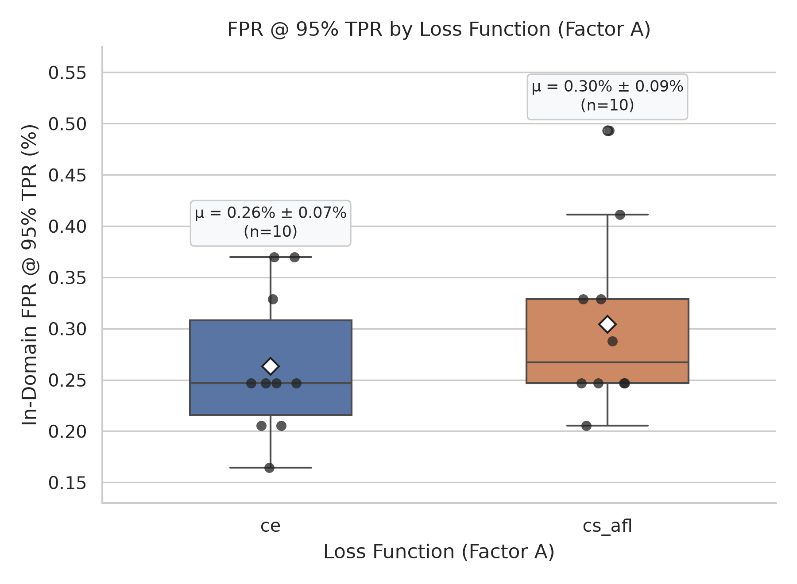

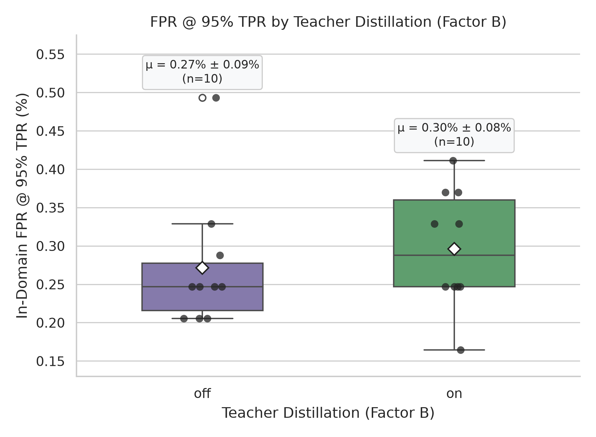

#### OOD NotInject FPR (at tau_95) (`notinject_fpr`)

| Grouping | Level / Cell | $n$ | Mean | SD | Median | IQR | Min | Max |
| :--- | :--- | :---: | :---: | :---: | :---: | :---: | :---: | :---: |
| Factor A (Loss) | `ce` | 10 | 18.67% | 3.17% | 17.55% | 4.42% | 15.63% | 24.19% |
| Factor A (Loss) | `cs_afl` | 10 | 22.39% | 3.67% | 22.71% | 5.24% | 15.93% | 26.84% |
| Factor B (Distillation) | `off` | 10 | 20.68% | 3.90% | 21.83% | 6.42% | 15.63% | 25.66% |
| Factor B (Distillation) | `on` | 10 | 20.38% | 3.99% | 19.17% | 6.05% | 15.93% | 26.84% |
| Cell (A × B) | `(ce, off)` | 5 | 17.82% | 3.17% | 16.52% | 1.77% | 15.63% | 23.30% |
| Cell (A × B) | `(ce, on)` | 5 | 19.53% | 3.27% | 18.29% | 4.13% | 16.22% | 24.19% |
| Cell (A × B) | `(cs_afl, off)` | 5 | 23.54% | 1.92% | 23.01% | 2.95% | 21.24% | 25.66% |
| Cell (A × B) | `(cs_afl, on)` | 5 | 21.24% | 4.82% | 20.06% | 7.96% | 15.93% | 26.84% |

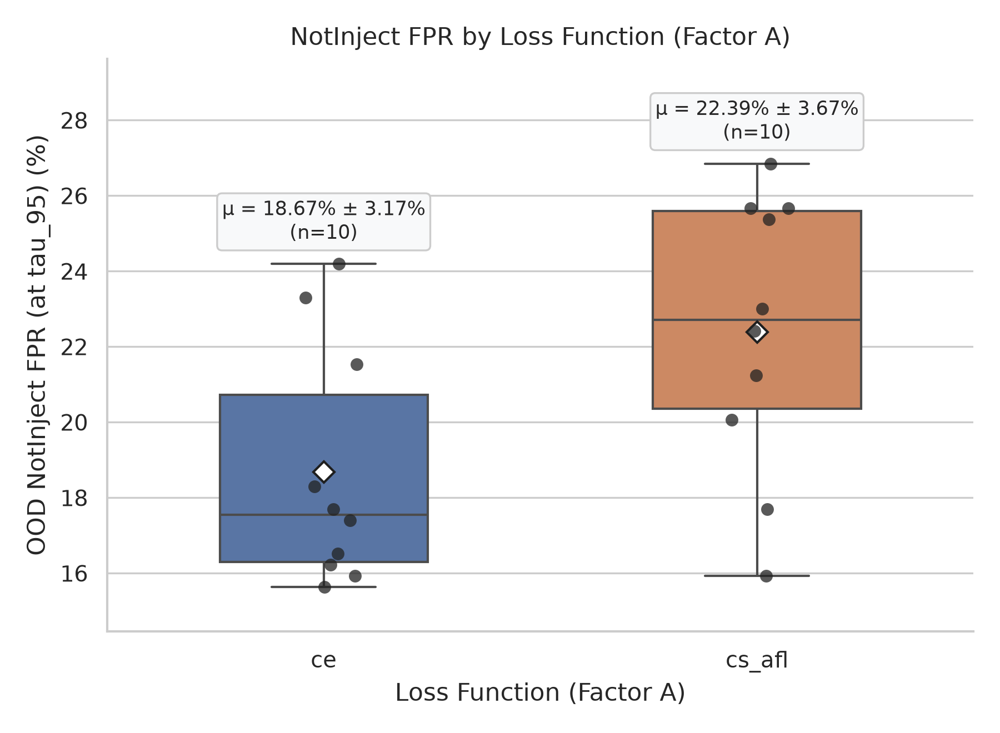

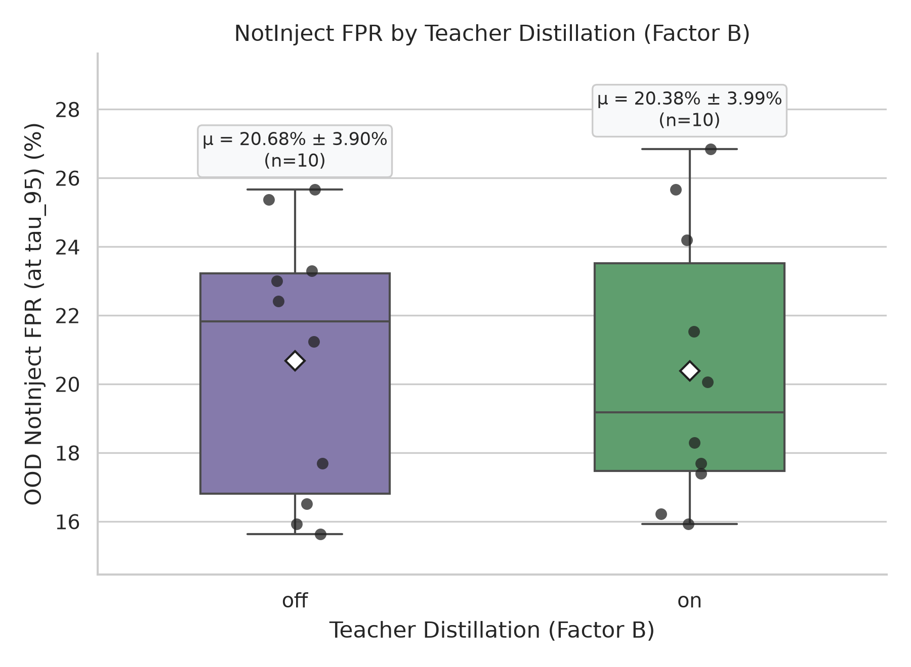

#### In-Domain 3-Class Macro-F1 (`macro_f1`)

| Grouping | Level / Cell | $n$ | Mean | SD | Median | IQR | Min | Max |
| :--- | :--- | :---: | :---: | :---: | :---: | :---: | :---: | :---: |
| Factor A (Loss) | `ce` | 10 | 0.9272 | 0.0054 | 0.9283 | 0.0051 | 0.9168 | 0.9362 |
| Factor A (Loss) | `cs_afl` | 10 | 0.9248 | 0.0058 | 0.9248 | 0.0092 | 0.9174 | 0.9340 |
| Factor B (Distillation) | `off` | 10 | 0.9286 | 0.0044 | 0.9284 | 0.0048 | 0.9210 | 0.9362 |
| Factor B (Distillation) | `on` | 10 | 0.9234 | 0.0056 | 0.9232 | 0.0094 | 0.9168 | 0.9319 |
| Cell (A × B) | `(ce, off)` | 5 | 0.9296 | 0.0040 | 0.9288 | 0.0018 | 0.9254 | 0.9362 |
| Cell (A × B) | `(ce, on)` | 5 | 0.9247 | 0.0058 | 0.9241 | 0.0063 | 0.9168 | 0.9319 |
| Cell (A × B) | `(cs_afl, off)` | 5 | 0.9275 | 0.0051 | 0.9267 | 0.0058 | 0.9210 | 0.9340 |
| Cell (A × B) | `(cs_afl, on)` | 5 | 0.9221 | 0.0056 | 0.9201 | 0.0071 | 0.9174 | 0.9305 |

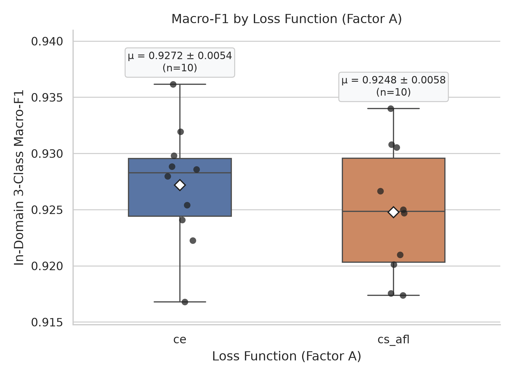

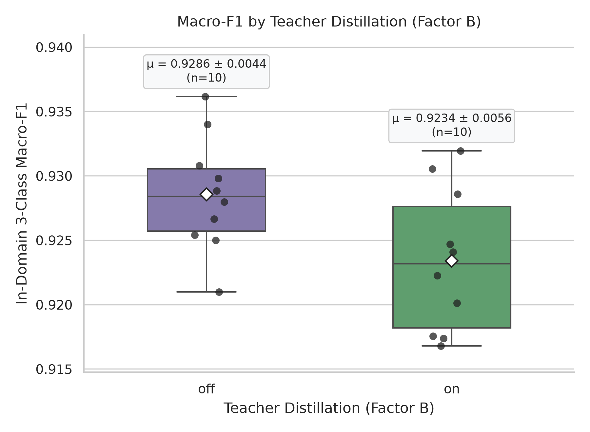

### 3.3 Model Validation (Residual Normality Q-Q Plots & Levene's Test)

| Response Variable | Shapiro-Wilk $W$ | Shapiro-Wilk $p$ | Normality ($\alpha=0.05$) | Levene $F(3,16)$ (mean) | Levene $p$ | Homoscedasticity ($\alpha=0.05$) | Brown-Forsythe $p$ |
| :--- | :---: | :---: | :---: | :---: | :---: | :---: | :---: |
| **FPR @ 95% TPR** (`fpr_at_95_tpr`) | 0.9224 | 0.1103 | PASS | 0.953 | 0.4386 | PASS | 0.8395 |
| **NotInject FPR** (`notinject_fpr`) | 0.9248 | 0.1228 | PASS | 2.244 | 0.1226 | PASS | 0.4467 |
| **Macro-F1** (`macro_f1`) | 0.9538 | 0.4276 | PASS | 0.466 | 0.7098 | PASS | 0.8384 |

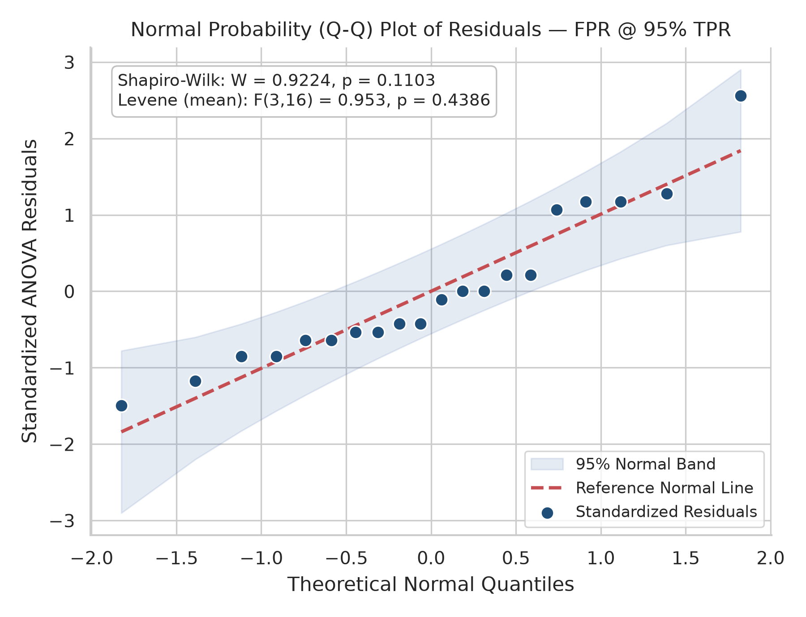

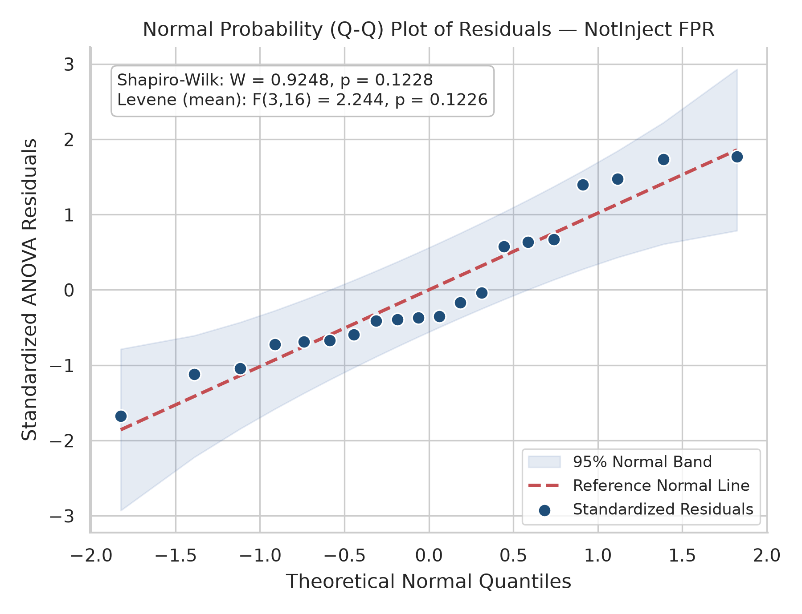

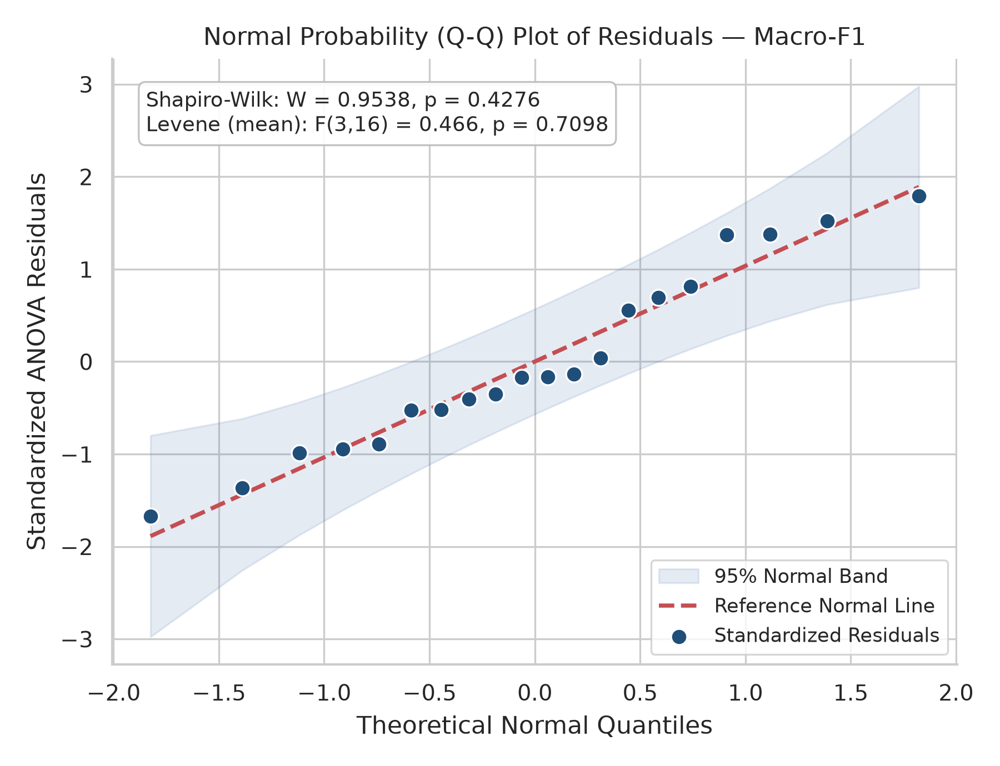

### 3.4 Two-Way ANOVA Tables, Interaction Plots, and Interpretation

#### Two-Way ANOVA — In-Domain FPR @ 95% TPR (`fpr_at_95_tpr`)

Model fit: $R^2 = 0.0949$, Adjusted $R^2 = -0.0749$ (balanced design verification: $\max |SS_{\text{II}} - SS_{\text{III}}| = 0.00e+00$).

| Source | $SS$ | $df$ | $MS$ | $F$ | $p$-value | $\eta^2$ | $\eta_p^2$ |
| :--- | :---: | :---: | :---: | :---: | :---: | :---: | :---: |
| Loss | 8.446675e-07 | 1 | 8.446675e-07 | 1.1976 | 0.2900 | 0.0678 | 0.0696 |
| Distillation | 3.040803e-07 | 1 | 3.040803e-07 | 0.4311 | 0.5208 | 0.0244 | 0.0262 |
| Loss:Distillation | 3.378670e-08 | 1 | 3.378670e-08 | 0.0479 | 0.8295 | 0.0027 | 0.0030 |
| Residual | 1.128476e-05 | 16 | 7.052974e-07 | — | — | 0.9051 | — |
| Total | 1.246729e-05 | 19 | 6.561733e-07 | — | — | 1.0000 | — |

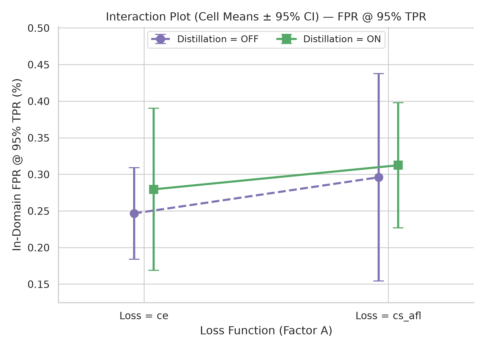

**Interpretation (FPR @ 95% TPR):** Both ANOVA parametric assumptions hold at $\alpha = 0.05$ (Shapiro-Wilk $W = 0.9224, p = 0.1103$; Levene $F(3, 16) = 0.953, p = 0.4386$). No statistically significant **Loss × Distillation interaction** is detected ($F(1, 16) = 0.048, p = 0.8295, \eta^2 = 0.003$), allowing direct interpretation of the main effects. **Factor A (Loss)** does not reach statistical significance at $\alpha = 0.05$ ($F(1, 16) = 1.198, p = 0.2900, \eta^2 = 0.068$; `cs_afl` = 0.30% vs `ce` = 0.26%). **Factor B (Distillation)** does not reach statistical significance at $\alpha = 0.05$ ($F(1, 16) = 0.431, p = 0.5208, \eta^2 = 0.024$; `on` = 0.30% vs `off` = 0.27%). Best cell mean for **FPR @ 95% TPR** (minimize): `(loss=ce, distillation=off)` with mean 0.25% (SD = 0.05%).

#### Two-Way ANOVA — OOD NotInject FPR (at tau_95) (`notinject_fpr`)

Model fit: $R^2 = 0.3198$, Adjusted $R^2 = 0.1923$ (balanced design verification: $\max |SS_{\text{II}} - SS_{\text{III}}| = 6.78e-20$).

| Source | $SS$ | $df$ | $MS$ | $F$ | $p$-value | $\eta^2$ | $\eta_p^2$ |
| :--- | :---: | :---: | :---: | :---: | :---: | :---: | :---: |
| Loss | 6.907354e-03 | 1 | 6.907354e-03 | 5.7973 | **0.0285*** | 0.2465 | 0.2660 |
| Distillation | 4.350815e-05 | 1 | 4.350815e-05 | 0.0365 | 0.8509 | 0.0016 | 0.0023 |
| Loss:Distillation | 2.011817e-03 | 1 | 2.011817e-03 | 1.6885 | 0.2122 | 0.0718 | 0.0955 |
| Residual | 1.906353e-02 | 16 | 1.191471e-03 | — | — | 0.6802 | — |
| Total | 2.802621e-02 | 19 | 1.475064e-03 | — | — | 1.0000 | — |

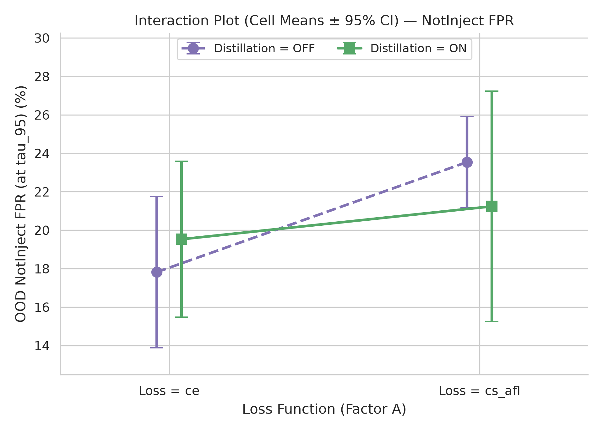

**Interpretation (NotInject FPR):** Both ANOVA parametric assumptions hold at $\alpha = 0.05$ (Shapiro-Wilk $W = 0.9248, p = 0.1228$; Levene $F(3, 16) = 2.244, p = 0.1226$). No statistically significant **Loss × Distillation interaction** is detected ($F(1, 16) = 1.689, p = 0.2122, \eta^2 = 0.072$), allowing direct interpretation of the main effects. **Factor A (Loss)** has a significant main effect ($F(1, 16) = 5.797, p = 0.0285, \eta^2 = 0.246$): `cs_afl` averages 22.39% vs `ce` at 18.67%. **Factor B (Distillation)** does not reach statistical significance at $\alpha = 0.05$ ($F(1, 16) = 0.037, p = 0.8509, \eta^2 = 0.002$; `on` = 20.38% vs `off` = 20.68%). Best cell mean for **NotInject FPR** (minimize): `(loss=ce, distillation=off)` with mean 17.82% (SD = 3.17%).

#### Two-Way ANOVA — In-Domain 3-Class Macro-F1 (`macro_f1`)

Model fit: $R^2 = 0.2756$, Adjusted $R^2 = 0.1398$ (balanced design verification: $\max |SS_{\text{II}} - SS_{\text{III}}| = 0.00e+00$).

| Source | $SS$ | $df$ | $MS$ | $F$ | $p$-value | $\eta^2$ | $\eta_p^2$ |
| :--- | :---: | :---: | :---: | :---: | :---: | :---: | :---: |
| Loss | 2.912556e-05 | 1 | 2.912556e-05 | 1.0892 | 0.3122 | 0.0493 | 0.0637 |
| Distillation | 1.332878e-04 | 1 | 1.332878e-04 | 4.9846 | **0.0402*** | 0.2257 | 0.2375 |
| Loss:Distillation | 3.579243e-07 | 1 | 3.579243e-07 | 0.0134 | 0.9093 | 0.0006 | 0.0008 |
| Residual | 4.278401e-04 | 16 | 2.674001e-05 | — | — | 0.7244 | — |
| Total | 5.906113e-04 | 19 | 3.108481e-05 | — | — | 1.0000 | — |

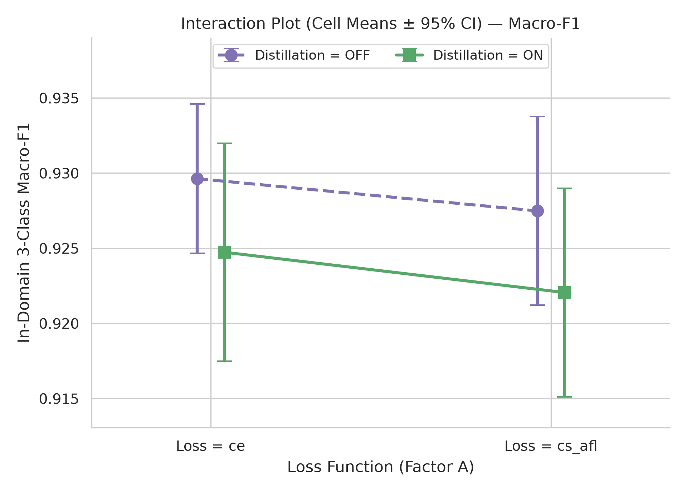

**Interpretation (Macro-F1):** Both ANOVA parametric assumptions hold at $\alpha = 0.05$ (Shapiro-Wilk $W = 0.9538, p = 0.4276$; Levene $F(3, 16) = 0.466, p = 0.7098$). No statistically significant **Loss × Distillation interaction** is detected ($F(1, 16) = 0.013, p = 0.9093, \eta^2 = 0.001$), allowing direct interpretation of the main effects. **Factor A (Loss)** does not reach statistical significance at $\alpha = 0.05$ ($F(1, 16) = 1.089, p = 0.3122, \eta^2 = 0.049$; `cs_afl` = 0.9248 vs `ce` = 0.9272). **Factor B (Distillation)** has a significant main effect ($F(1, 16) = 4.985, p = 0.0402, \eta^2 = 0.226$): `on` averages 0.9234 vs `off` at 0.9286. Best cell mean for **Macro-F1** (maximize): `(loss=ce, distillation=off)` with mean 0.9296 (SD = 0.0040).

### 3.5 Recommendation of the Best Treatment Combination

Synthesizing the primary inline-security objective (`fpr_at_95_tpr`, weight 45%), OOD benign trigger-word resistance (`notinject_fpr`, weight 35%), and 3-class utility (`macro_f1`, weight 20%), the recommended treatment combination is **`loss = ce` + `distillation = off`**.

| Treatment `(Loss, Distillation)` | FPR @ 95% TPR (Mean ± SD) | NotInject FPR (Mean ± SD) | Macro-F1 (Mean ± SD) | Weighted Rank |
| :--- | :---: | :---: | :---: | :---: |
| **`(ce, off)` (Recommended)** | 0.25% ± 0.05% | 17.82% ± 3.17% | 0.9296 ± 0.0040 | 1.00 |
| `(ce, on)` | 0.28% ± 0.09% | 19.53% ± 3.27% | 0.9247 ± 0.0058 | 2.20 |
| `(cs_afl, off)` | 0.30% ± 0.11% | 23.54% ± 1.92% | 0.9275 ± 0.0051 | 3.15 |
| `(cs_afl, on)` | 0.31% ± 0.07% | 21.24% ± 4.82% | 0.9221 ± 0.0056 | 3.65 |

<!-- DOE_RESULTS_END -->

---

### 3.6 Statistical Tool Options & Verification Screenshots

To guarantee full auditability against standard statistical software (JASP / Jamovi / SPSS), `reports/doe/doe_raw_data.csv` is formatted in tidy tabular layout (`run_id, loss, distillation, seed, macro_f1, roc_auc, fpr_at_95_tpr, notinject_fpr, ece`) and cross-verified with both Python (`statsmodels` OLS Type II/III ANOVA + `scipy.stats`) and interactive GUI statistical tooling.

#### Reproducible Python Statistical Specification
- **Command:** `.venv/bin/python scripts/analyze_doe_anova.py --preds-dir reports/predictions_doe_fast --update-report docs/milestone2_doe_report.md`
- **Model Formula:** `response ~ C(loss, Sum) * C(distillation, Sum)` (balanced $2 \times 2 \times 5$; Type II $\equiv$ Type III SS)
- **Diagnostic Tests:** Shapiro-Wilk normality test on ANOVA residuals (`scipy.stats.shapiro`), Normal Probability Q-Q plot (`scipy.stats.probplot`), Levene's test for equality of variances (`scipy.stats.levene(..., center="mean")` and Brown-Forsythe `center="median"`), and Tukey HSD post-hoc (`statsmodels.stats.multicomp.pairwise_tukeyhsd`).

#### GUI Statistical Tool Options Screenshots (Jamovi Cloud — Exact Parity Verification)

Cross-verified in **Jamovi Cloud (`cloud.jamovi.org`)** on `reports/doe/doe_raw_data.csv` (`ANOVA → ANOVA`, Dependent Variable: `notinject_fpr`, Fixed Factors: `loss`, `distillation`, Sum of Squares: `Type 3`). All Jamovi statistics match Python `statsmodels`/`scipy` to reported precision (`loss F = 5.7973, p = .028, η² = 0.246, η²p = 0.266`; `distillation F = 0.0365, p = .851`; `loss * distillation F = 1.6885, p = .212`; `Levene F(3,16) = 2.24, p = .123`; `Shapiro-Wilk W = 0.925, p = .123`).

**Screenshot 1 — ANOVA Model, Type III Sum of Squares & Effect Sizes (`η²`, `η²p`, `ω²`):**

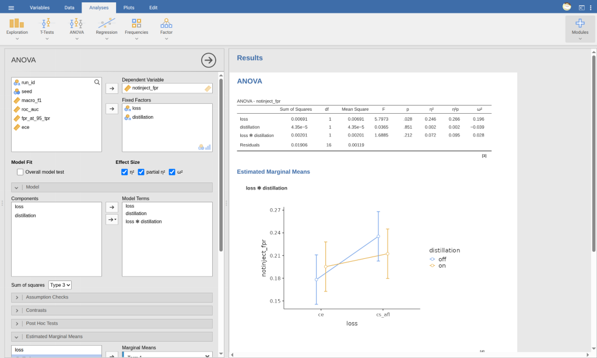

**Screenshot 2 — Assumption Checks (`Levene's` Homogeneity, `Shapiro-Wilk` Normality & `Q-Q Plot`):**

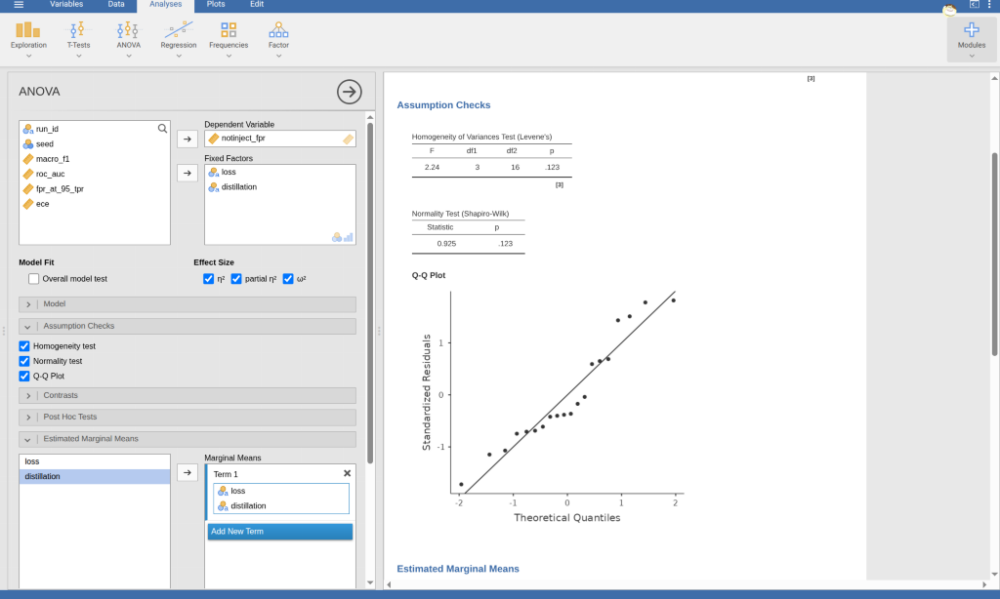

**Screenshot 3 — Estimated Marginal Means & Interaction Plot (`loss * distillation`, 95% CI):**

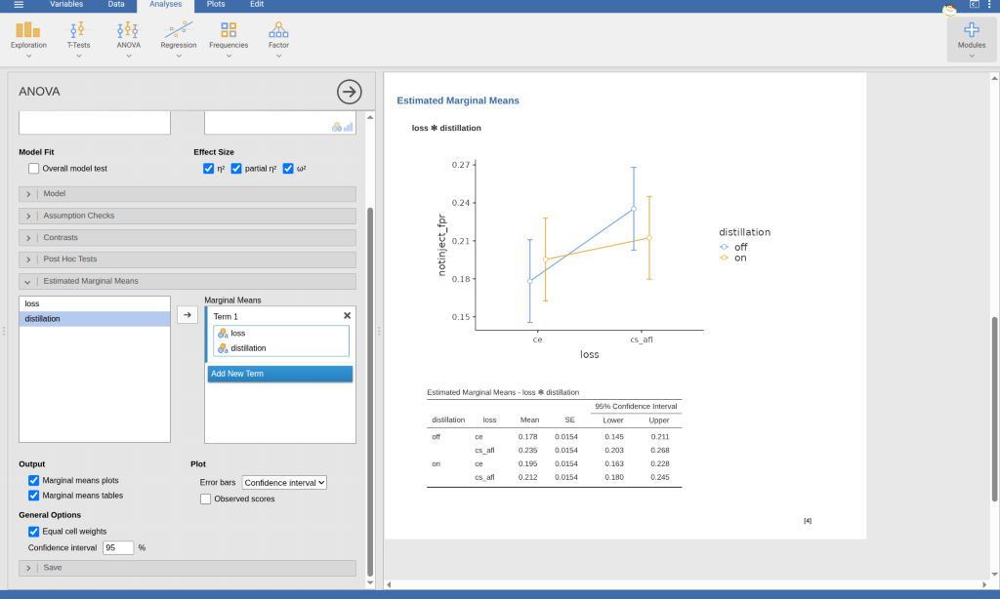
