# AegisLLM — Milestone 2 DOE Statistical Analysis Summary

### 3.1 Raw Experimental Data ($N = 20$ Runs)

Complete tidy dataset exported to `reports/doe/doe_raw_data.csv` (directly importable in JASP, Jamovi, and SPSS). All operating points (`tau_95`) and temperatures (`T`) were calibrated strictly on Validation (`N = 4,439`) prior to blind Test (`N = 4,438`) and OOD `NotInject` (`N = 339`) evaluation.

| # | Run ID | Loss (A) | Distillation (B) | Seed | FPR @ 95% TPR | NotInject FPR | Macro-F1 | ROC-AUC | ECE |
| :---: | :--- | :---: | :---: | :---: | :---: | :---: | :---: | :---: | :---: |
| 1 | `deberta_v3_small_ce_no_distill_seed42` | `ce` | `off` | `42` | 0.33% (0.00329) | 16.52% (0.16519) | 0.9254 | 0.99778 | 0.0130 |
| 2 | `deberta_v3_small_ce_no_distill_seed777` | `ce` | `off` | `777` | 0.21% (0.00206) | 15.93% (0.15929) | 0.9280 | 0.99575 | 0.0114 |
| 3 | `deberta_v3_small_ce_no_distill_seed999` | `ce` | `off` | `999` | 0.21% (0.00206) | 17.70% (0.17699) | 0.9298 | 0.99559 | 0.0170 |
| 4 | `deberta_v3_small_ce_no_distill_seed1337` | `ce` | `off` | `1337` | 0.25% (0.00247) | 15.63% (0.15634) | 0.9362 | 0.99744 | 0.0082 |
| 5 | `deberta_v3_small_ce_no_distill_seed2026` | `ce` | `off` | `2026` | 0.25% (0.00247) | 23.30% (0.23304) | 0.9288 | 0.99698 | 0.0114 |
| 6 | `deberta_v3_small_ce_seed42` | `ce` | `on` | `42` | 0.37% (0.00370) | 21.53% (0.21534) | 0.9241 | 0.99809 | 0.0137 |
| 7 | `deberta_v3_small_ce_seed777` | `ce` | `on` | `777` | 0.16% (0.00164) | 17.40% (0.17404) | 0.9168 | 0.99782 | 0.0156 |
| 8 | `deberta_v3_small_ce_seed999` | `ce` | `on` | `999` | 0.25% (0.00247) | 18.29% (0.18289) | 0.9286 | 0.99801 | 0.0133 |
| 9 | `deberta_v3_small_ce_seed1337` | `ce` | `on` | `1337` | 0.25% (0.00247) | 16.22% (0.16224) | 0.9319 | 0.99815 | 0.0086 |
| 10 | `deberta_v3_small_ce_seed2026` | `ce` | `on` | `2026` | 0.37% (0.00370) | 24.19% (0.24189) | 0.9223 | 0.99791 | 0.0144 |
| 11 | `deberta_v3_small_cs_afl_no_distill_seed42` | `cs_afl` | `off` | `42` | 0.49% (0.00493) | 25.66% (0.25664) | 0.9210 | 0.99854 | 0.0084 |
| 12 | `deberta_v3_small_cs_afl_no_distill_seed777` | `cs_afl` | `off` | `777` | 0.25% (0.00247) | 22.42% (0.22419) | 0.9250 | 0.99711 | 0.0102 |
| 13 | `deberta_v3_small_cs_afl_no_distill_seed999` | `cs_afl` | `off` | `999` | 0.29% (0.00288) | 23.01% (0.23009) | 0.9308 | 0.99809 | 0.0105 |
| 14 | `deberta_v3_small_cs_afl_no_distill_seed1337` | `cs_afl` | `off` | `1337` | 0.25% (0.00247) | 21.24% (0.21239) | 0.9340 | 0.99827 | 0.0077 |
| 15 | `deberta_v3_small_cs_afl_no_distill_seed2026` | `cs_afl` | `off` | `2026` | 0.21% (0.00206) | 25.37% (0.25369) | 0.9267 | 0.99794 | 0.0095 |
| 16 | `deberta_v3_small_cs_afl_seed42` | `cs_afl` | `on` | `42` | 0.41% (0.00411) | 20.06% (0.20059) | 0.9174 | 0.99831 | 0.0131 |
| 17 | `deberta_v3_small_cs_afl_seed777` | `cs_afl` | `on` | `777` | 0.33% (0.00329) | 25.66% (0.25664) | 0.9175 | 0.99771 | 0.0141 |
| 18 | `deberta_v3_small_cs_afl_seed999` | `cs_afl` | `on` | `999` | 0.25% (0.00247) | 15.93% (0.15929) | 0.9247 | 0.99807 | 0.0099 |
| 19 | `deberta_v3_small_cs_afl_seed1337` | `cs_afl` | `on` | `1337` | 0.25% (0.00247) | 17.70% (0.17699) | 0.9305 | 0.99845 | 0.0098 |
| 20 | `deberta_v3_small_cs_afl_seed2026` | `cs_afl` | `on` | `2026` | 0.33% (0.00329) | 26.84% (0.26844) | 0.9201 | 0.99803 | 0.0109 |

### 3.2 Descriptive Statistics and Factor Boxplots

#### In-Domain FPR @ 95% TPR (`fpr_at_95_tpr`)

| Grouping | Level / Cell | $n$ | Mean | SD | Median | IQR | Min | Max |
| :--- | :--- | :---: | :---: | :---: | :---: | :---: | :---: | :---: |
| Factor A (Loss) | `ce` | 10 | 0.26% | 0.07% | 0.25% | 0.09% | 0.16% | 0.37% |
| Factor A (Loss) | `cs_afl` | 10 | 0.30% | 0.09% | 0.27% | 0.08% | 0.21% | 0.49% |
| Factor B (Distillation) | `off` | 10 | 0.27% | 0.09% | 0.25% | 0.06% | 0.21% | 0.49% |
| Factor B (Distillation) | `on` | 10 | 0.30% | 0.08% | 0.29% | 0.11% | 0.16% | 0.41% |
| Cell (A × B) | `(ce, off)` | 5 | 0.25% | 0.05% | 0.25% | 0.04% | 0.21% | 0.33% |
| Cell (A × B) | `(ce, on)` | 5 | 0.28% | 0.09% | 0.25% | 0.12% | 0.16% | 0.37% |
| Cell (A × B) | `(cs_afl, off)` | 5 | 0.30% | 0.11% | 0.25% | 0.04% | 0.21% | 0.49% |
| Cell (A × B) | `(cs_afl, on)` | 5 | 0.31% | 0.07% | 0.33% | 0.08% | 0.25% | 0.41% |

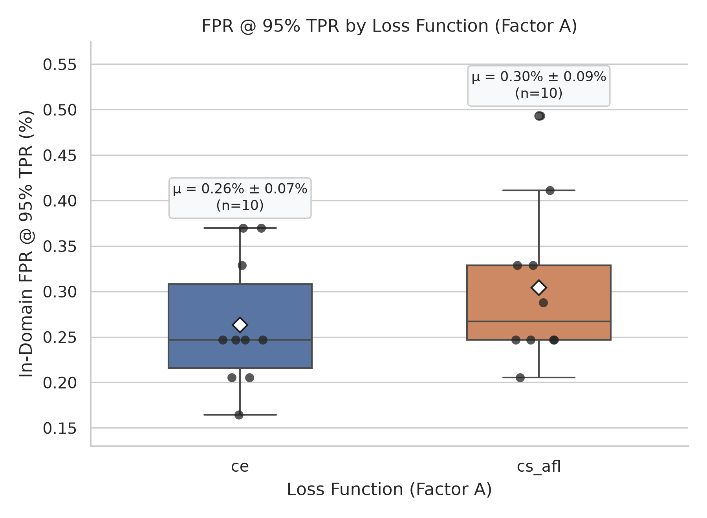

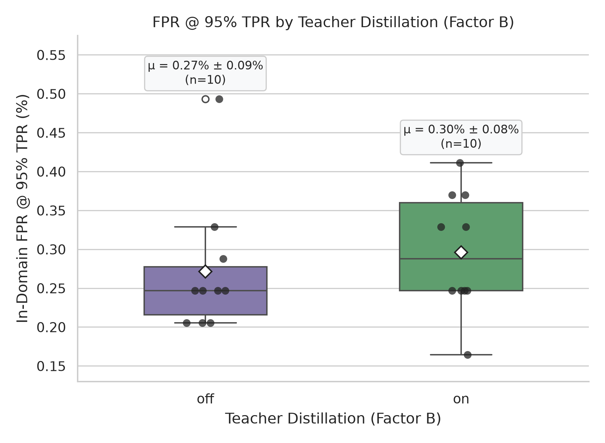

#### OOD NotInject FPR (at tau_95) (`notinject_fpr`)

| Grouping | Level / Cell | $n$ | Mean | SD | Median | IQR | Min | Max |
| :--- | :--- | :---: | :---: | :---: | :---: | :---: | :---: | :---: |
| Factor A (Loss) | `ce` | 10 | 18.67% | 3.17% | 17.55% | 4.42% | 15.63% | 24.19% |
| Factor A (Loss) | `cs_afl` | 10 | 22.39% | 3.67% | 22.71% | 5.24% | 15.93% | 26.84% |
| Factor B (Distillation) | `off` | 10 | 20.68% | 3.90% | 21.83% | 6.42% | 15.63% | 25.66% |
| Factor B (Distillation) | `on` | 10 | 20.38% | 3.99% | 19.17% | 6.05% | 15.93% | 26.84% |
| Cell (A × B) | `(ce, off)` | 5 | 17.82% | 3.17% | 16.52% | 1.77% | 15.63% | 23.30% |
| Cell (A × B) | `(ce, on)` | 5 | 19.53% | 3.27% | 18.29% | 4.13% | 16.22% | 24.19% |
| Cell (A × B) | `(cs_afl, off)` | 5 | 23.54% | 1.92% | 23.01% | 2.95% | 21.24% | 25.66% |
| Cell (A × B) | `(cs_afl, on)` | 5 | 21.24% | 4.82% | 20.06% | 7.96% | 15.93% | 26.84% |

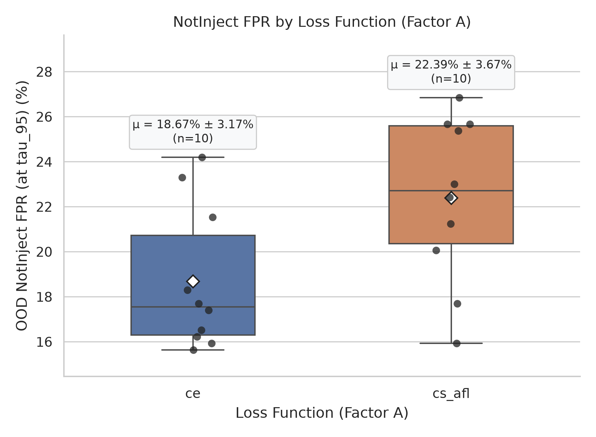

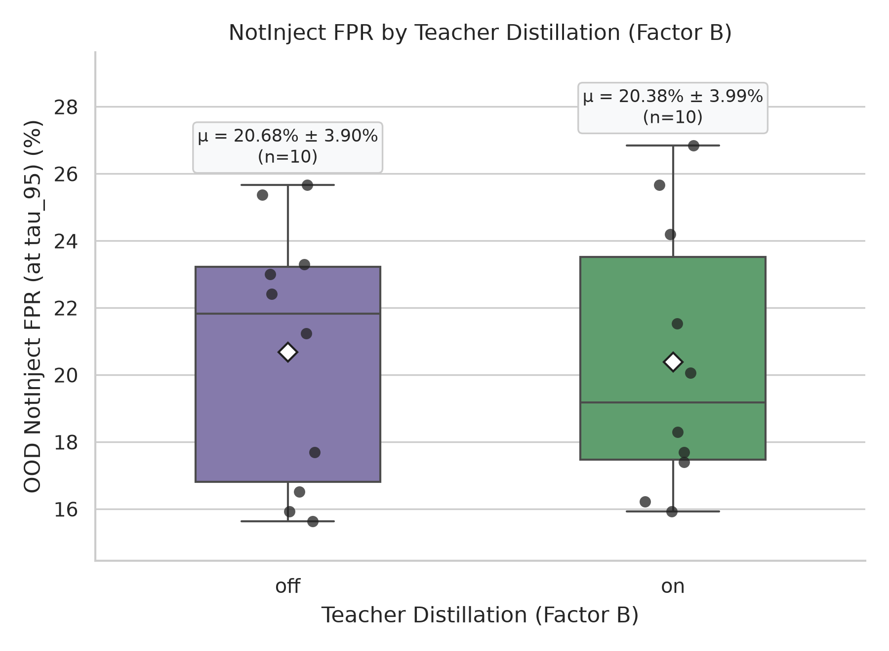

#### In-Domain 3-Class Macro-F1 (`macro_f1`)

| Grouping | Level / Cell | $n$ | Mean | SD | Median | IQR | Min | Max |
| :--- | :--- | :---: | :---: | :---: | :---: | :---: | :---: | :---: |
| Factor A (Loss) | `ce` | 10 | 0.9272 | 0.0054 | 0.9283 | 0.0051 | 0.9168 | 0.9362 |
| Factor A (Loss) | `cs_afl` | 10 | 0.9248 | 0.0058 | 0.9248 | 0.0092 | 0.9174 | 0.9340 |
| Factor B (Distillation) | `off` | 10 | 0.9286 | 0.0044 | 0.9284 | 0.0048 | 0.9210 | 0.9362 |
| Factor B (Distillation) | `on` | 10 | 0.9234 | 0.0056 | 0.9232 | 0.0094 | 0.9168 | 0.9319 |
| Cell (A × B) | `(ce, off)` | 5 | 0.9296 | 0.0040 | 0.9288 | 0.0018 | 0.9254 | 0.9362 |
| Cell (A × B) | `(ce, on)` | 5 | 0.9247 | 0.0058 | 0.9241 | 0.0063 | 0.9168 | 0.9319 |
| Cell (A × B) | `(cs_afl, off)` | 5 | 0.9275 | 0.0051 | 0.9267 | 0.0058 | 0.9210 | 0.9340 |
| Cell (A × B) | `(cs_afl, on)` | 5 | 0.9221 | 0.0056 | 0.9201 | 0.0071 | 0.9174 | 0.9305 |

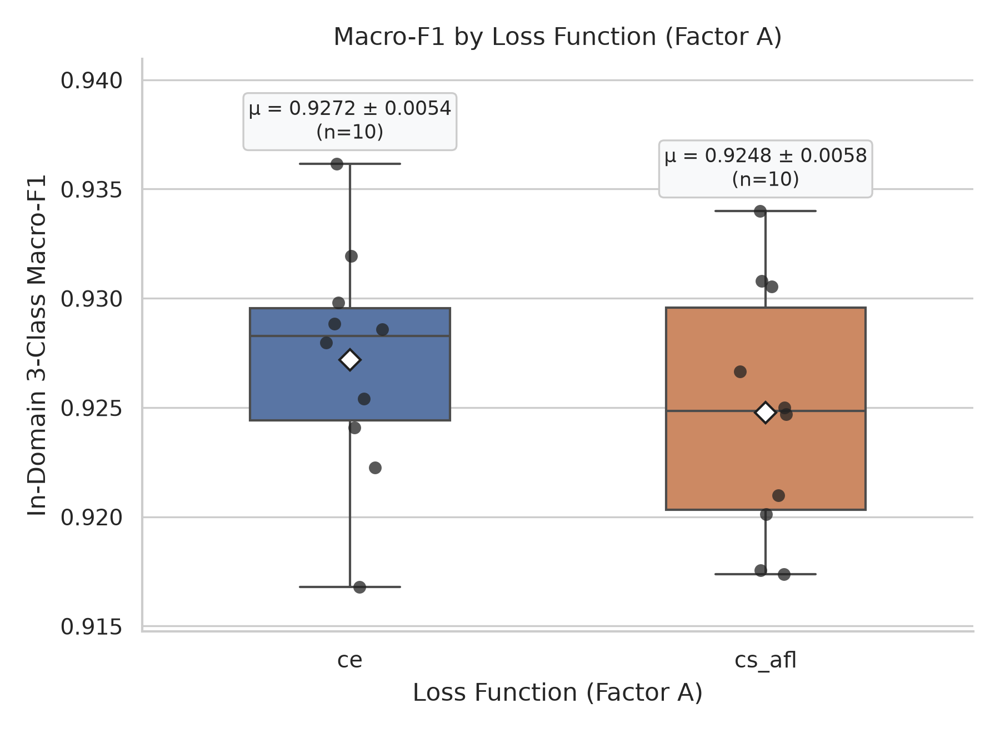

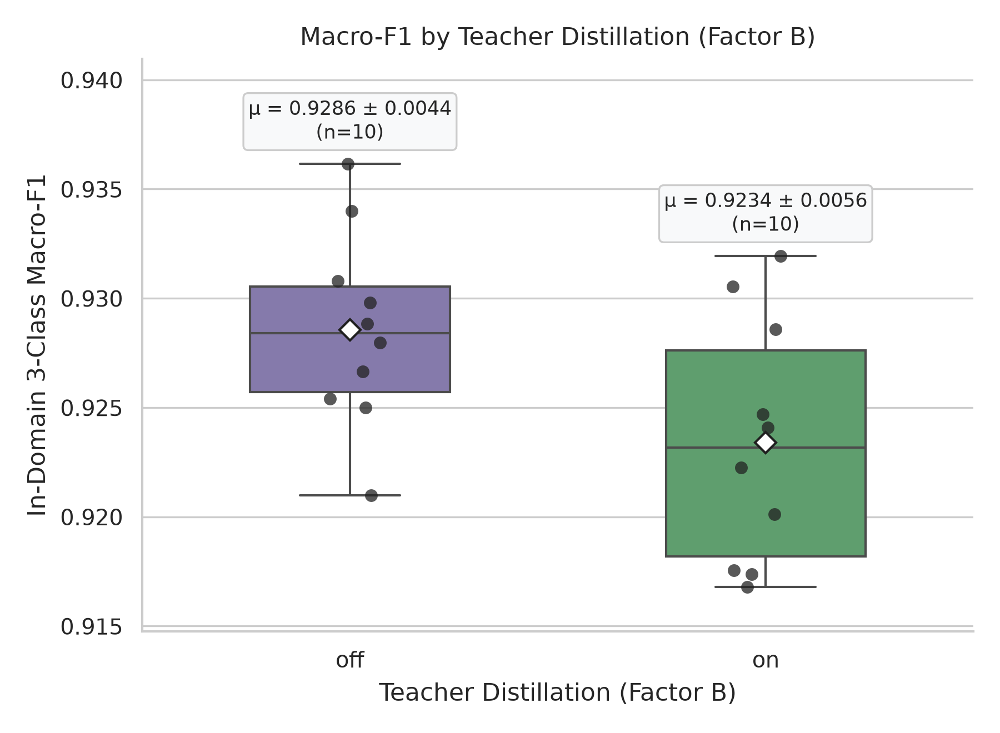

### 3.3 Model Validation (Residual Normality Q-Q Plots & Levene's Test)

| Response Variable | Shapiro-Wilk $W$ | Shapiro-Wilk $p$ | Normality ($\alpha=0.05$) | Levene $F(3,16)$ (mean) | Levene $p$ | Homoscedasticity ($\alpha=0.05$) | Brown-Forsythe $p$ |
| :--- | :---: | :---: | :---: | :---: | :---: | :---: | :---: |
| **FPR @ 95% TPR** (`fpr_at_95_tpr`) | 0.9224 | 0.1103 | PASS | 0.953 | 0.4386 | PASS | 0.8395 |
| **NotInject FPR** (`notinject_fpr`) | 0.9248 | 0.1228 | PASS | 2.244 | 0.1226 | PASS | 0.4467 |
| **Macro-F1** (`macro_f1`) | 0.9538 | 0.4276 | PASS | 0.466 | 0.7098 | PASS | 0.8384 |

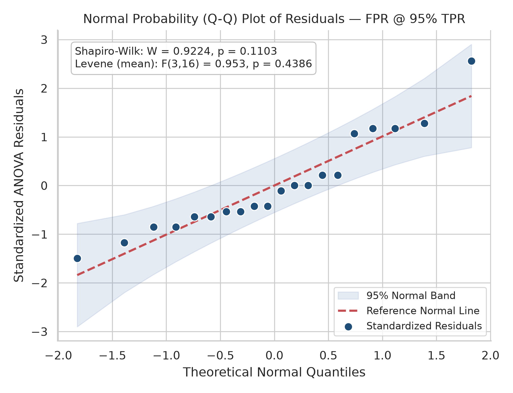

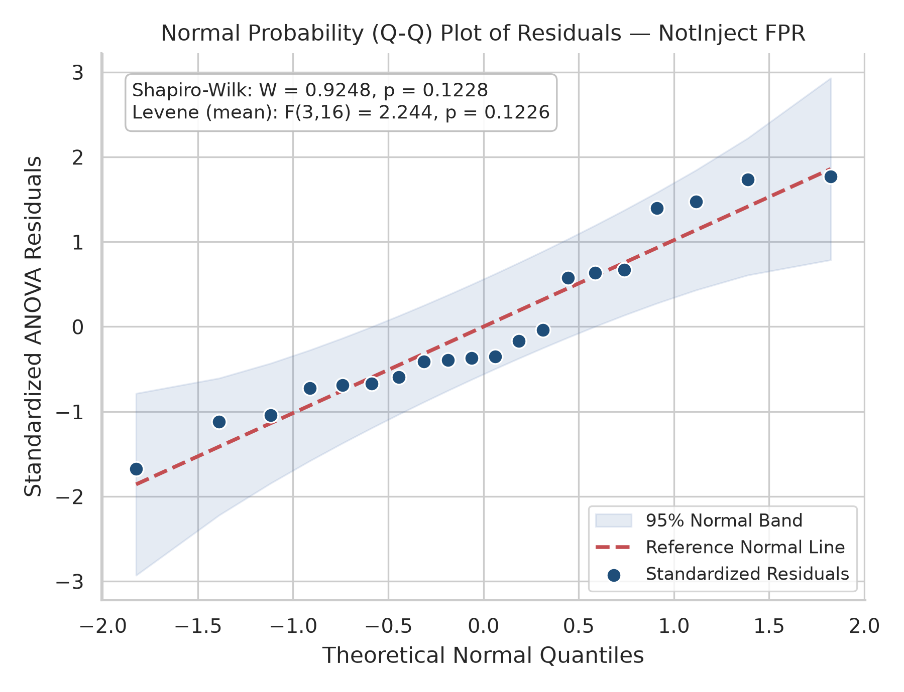

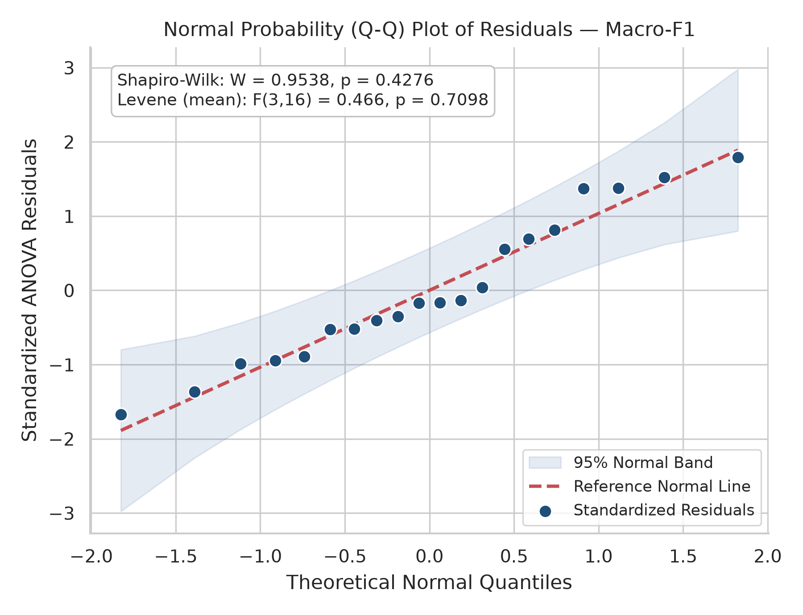

### 3.4 Two-Way ANOVA Tables, Interaction Plots, and Interpretation

#### Two-Way ANOVA — In-Domain FPR @ 95% TPR (`fpr_at_95_tpr`)

Model fit: $R^2 = 0.0949$, Adjusted $R^2 = -0.0749$ (balanced design verification: $\max |SS_{\text{II}} - SS_{\text{III}}| = 0.00e+00$).

| Source | $SS$ | $df$ | $MS$ | $F$ | $p$-value | $\eta^2$ | $\eta_p^2$ |
| :--- | :---: | :---: | :---: | :---: | :---: | :---: | :---: |
| Loss | 8.446675e-07 | 1 | 8.446675e-07 | 1.1976 | 0.2900 | 0.0678 | 0.0696 |
| Distillation | 3.040803e-07 | 1 | 3.040803e-07 | 0.4311 | 0.5208 | 0.0244 | 0.0262 |
| Loss:Distillation | 3.378670e-08 | 1 | 3.378670e-08 | 0.0479 | 0.8295 | 0.0027 | 0.0030 |
| Residual | 1.128476e-05 | 16 | 7.052974e-07 | — | — | 0.9051 | — |
| Total | 1.246729e-05 | 19 | 6.561733e-07 | — | — | 1.0000 | — |

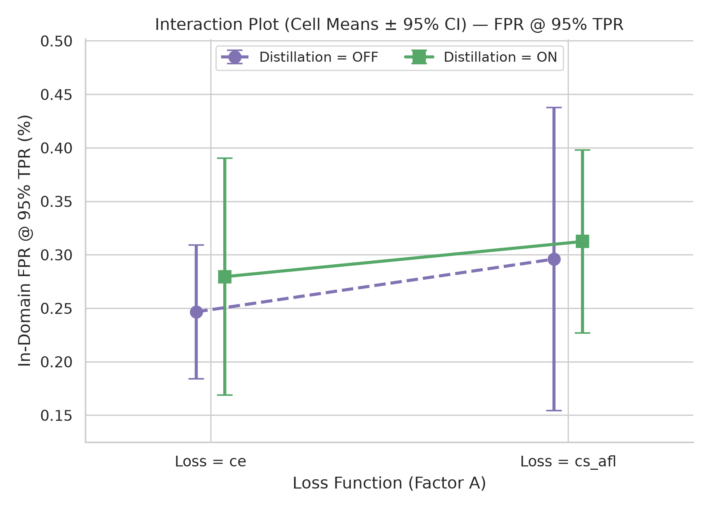

**Interpretation (FPR @ 95% TPR):** Both ANOVA parametric assumptions hold at $\alpha = 0.05$ (Shapiro-Wilk $W = 0.9224, p = 0.1103$; Levene $F(3, 16) = 0.953, p = 0.4386$). No statistically significant **Loss × Distillation interaction** is detected ($F(1, 16) = 0.048, p = 0.8295, \eta^2 = 0.003$), allowing direct interpretation of the main effects. **Factor A (Loss)** does not reach statistical significance at $\alpha = 0.05$ ($F(1, 16) = 1.198, p = 0.2900, \eta^2 = 0.068$; `cs_afl` = 0.30% vs `ce` = 0.26%). **Factor B (Distillation)** does not reach statistical significance at $\alpha = 0.05$ ($F(1, 16) = 0.431, p = 0.5208, \eta^2 = 0.024$; `on` = 0.30% vs `off` = 0.27%). Best cell mean for **FPR @ 95% TPR** (minimize): `(loss=ce, distillation=off)` with mean 0.25% (SD = 0.05%).

#### Two-Way ANOVA — OOD NotInject FPR (at tau_95) (`notinject_fpr`)

Model fit: $R^2 = 0.3198$, Adjusted $R^2 = 0.1923$ (balanced design verification: $\max |SS_{\text{II}} - SS_{\text{III}}| = 6.78e-20$).

| Source | $SS$ | $df$ | $MS$ | $F$ | $p$-value | $\eta^2$ | $\eta_p^2$ |
| :--- | :---: | :---: | :---: | :---: | :---: | :---: | :---: |
| Loss | 6.907354e-03 | 1 | 6.907354e-03 | 5.7973 | **0.0285*** | 0.2465 | 0.2660 |
| Distillation | 4.350815e-05 | 1 | 4.350815e-05 | 0.0365 | 0.8509 | 0.0016 | 0.0023 |
| Loss:Distillation | 2.011817e-03 | 1 | 2.011817e-03 | 1.6885 | 0.2122 | 0.0718 | 0.0955 |
| Residual | 1.906353e-02 | 16 | 1.191471e-03 | — | — | 0.6802 | — |
| Total | 2.802621e-02 | 19 | 1.475064e-03 | — | — | 1.0000 | — |

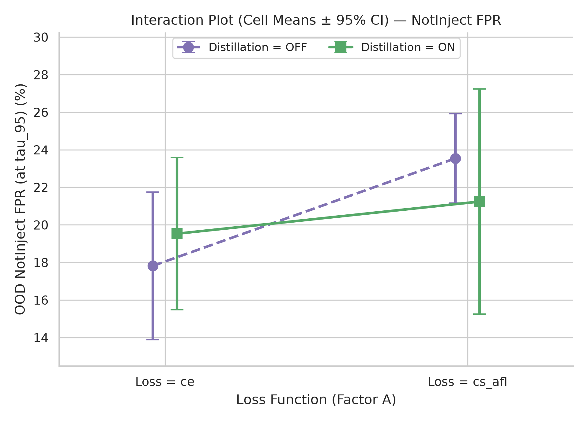

**Interpretation (NotInject FPR):** Both ANOVA parametric assumptions hold at $\alpha = 0.05$ (Shapiro-Wilk $W = 0.9248, p = 0.1228$; Levene $F(3, 16) = 2.244, p = 0.1226$). No statistically significant **Loss × Distillation interaction** is detected ($F(1, 16) = 1.689, p = 0.2122, \eta^2 = 0.072$), allowing direct interpretation of the main effects. **Factor A (Loss)** has a significant main effect ($F(1, 16) = 5.797, p = 0.0285, \eta^2 = 0.246$): `cs_afl` averages 22.39% vs `ce` at 18.67%. **Factor B (Distillation)** does not reach statistical significance at $\alpha = 0.05$ ($F(1, 16) = 0.037, p = 0.8509, \eta^2 = 0.002$; `on` = 20.38% vs `off` = 20.68%). Best cell mean for **NotInject FPR** (minimize): `(loss=ce, distillation=off)` with mean 17.82% (SD = 3.17%).

#### Two-Way ANOVA — In-Domain 3-Class Macro-F1 (`macro_f1`)

Model fit: $R^2 = 0.2756$, Adjusted $R^2 = 0.1398$ (balanced design verification: $\max |SS_{\text{II}} - SS_{\text{III}}| = 0.00e+00$).

| Source | $SS$ | $df$ | $MS$ | $F$ | $p$-value | $\eta^2$ | $\eta_p^2$ |
| :--- | :---: | :---: | :---: | :---: | :---: | :---: | :---: |
| Loss | 2.912556e-05 | 1 | 2.912556e-05 | 1.0892 | 0.3122 | 0.0493 | 0.0637 |
| Distillation | 1.332878e-04 | 1 | 1.332878e-04 | 4.9846 | **0.0402*** | 0.2257 | 0.2375 |
| Loss:Distillation | 3.579243e-07 | 1 | 3.579243e-07 | 0.0134 | 0.9093 | 0.0006 | 0.0008 |
| Residual | 4.278401e-04 | 16 | 2.674001e-05 | — | — | 0.7244 | — |
| Total | 5.906113e-04 | 19 | 3.108481e-05 | — | — | 1.0000 | — |

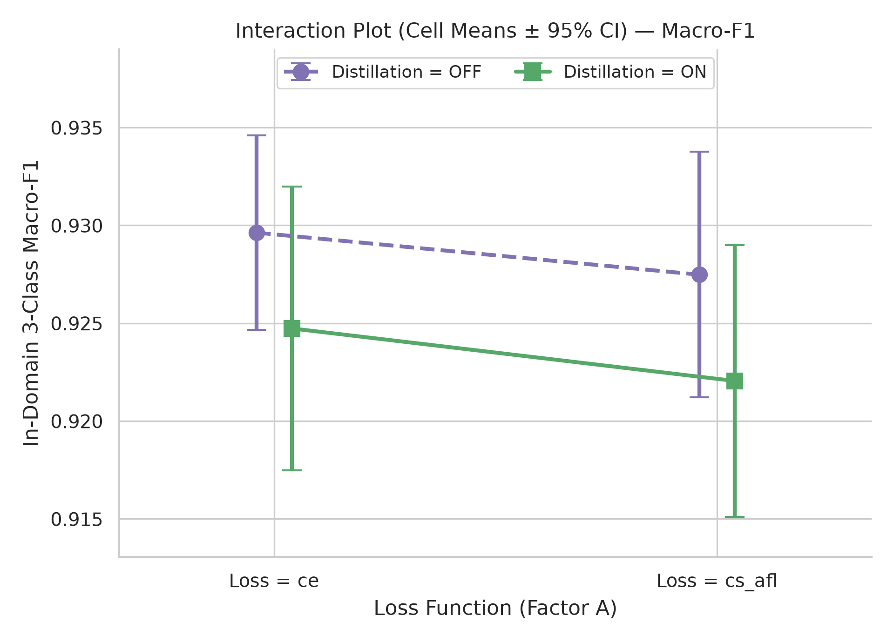

**Interpretation (Macro-F1):** Both ANOVA parametric assumptions hold at $\alpha = 0.05$ (Shapiro-Wilk $W = 0.9538, p = 0.4276$; Levene $F(3, 16) = 0.466, p = 0.7098$). No statistically significant **Loss × Distillation interaction** is detected ($F(1, 16) = 0.013, p = 0.9093, \eta^2 = 0.001$), allowing direct interpretation of the main effects. **Factor A (Loss)** does not reach statistical significance at $\alpha = 0.05$ ($F(1, 16) = 1.089, p = 0.3122, \eta^2 = 0.049$; `cs_afl` = 0.9248 vs `ce` = 0.9272). **Factor B (Distillation)** has a significant main effect ($F(1, 16) = 4.985, p = 0.0402, \eta^2 = 0.226$): `on` averages 0.9234 vs `off` at 0.9286. Best cell mean for **Macro-F1** (maximize): `(loss=ce, distillation=off)` with mean 0.9296 (SD = 0.0040).

### 3.5 Recommendation of the Best Treatment Combination

Synthesizing the primary inline-security objective (`fpr_at_95_tpr`, weight 45%), OOD benign trigger-word resistance (`notinject_fpr`, weight 35%), and 3-class utility (`macro_f1`, weight 20%), the recommended treatment combination is **`loss = ce` + `distillation = off`**.

| Treatment `(Loss, Distillation)` | FPR @ 95% TPR (Mean ± SD) | NotInject FPR (Mean ± SD) | Macro-F1 (Mean ± SD) | Weighted Rank |
| :--- | :---: | :---: | :---: | :---: |
| **`(ce, off)` (Recommended)** | 0.25% ± 0.05% | 17.82% ± 3.17% | 0.9296 ± 0.0040 | 1.00 |
| `(ce, on)` | 0.28% ± 0.09% | 19.53% ± 3.27% | 0.9247 ± 0.0058 | 2.20 |
| `(cs_afl, off)` | 0.30% ± 0.11% | 23.54% ± 1.92% | 0.9275 ± 0.0051 | 3.15 |
| `(cs_afl, on)` | 0.31% ± 0.07% | 21.24% ± 4.82% | 0.9221 ± 0.0056 | 3.65 |
